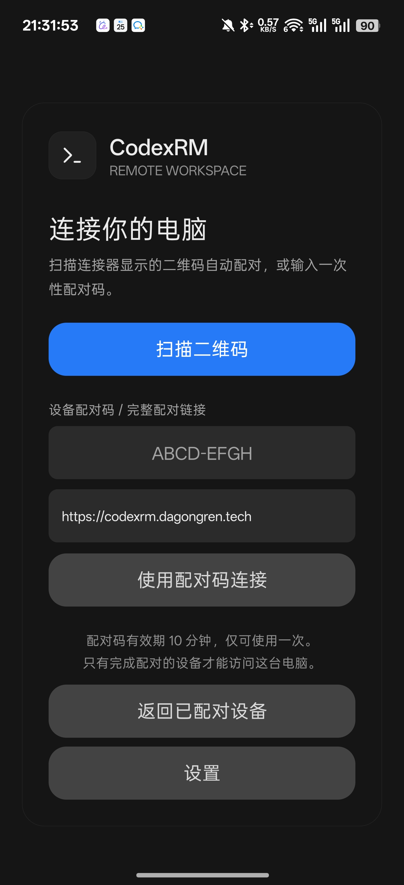
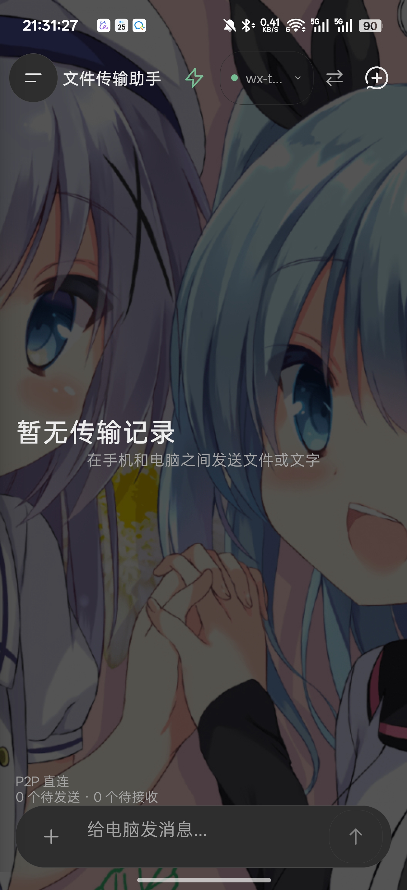
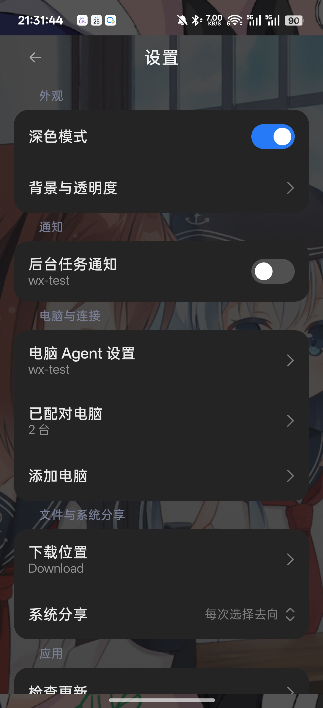
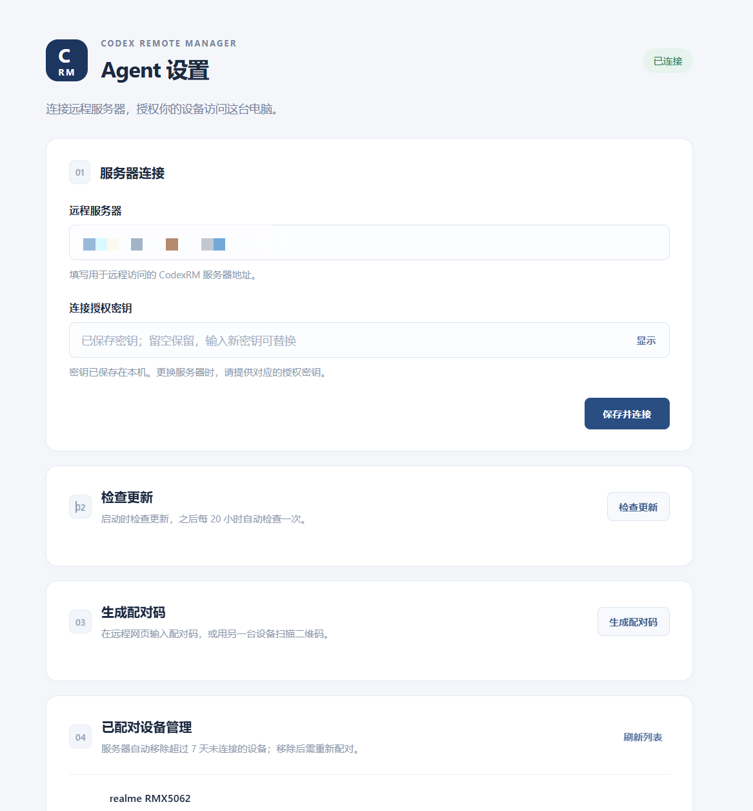
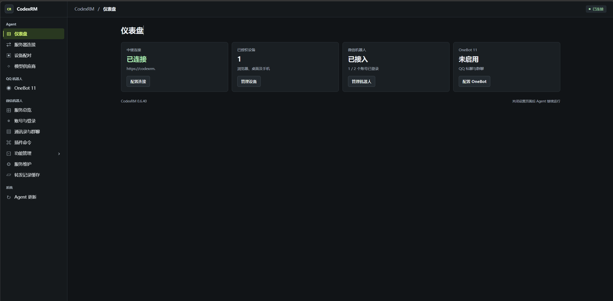

# CodexRM

**用 Android 手机远程操作电脑上的 Codex。** 扫码配对后，可以在手机上切换工作区、继续已有会话、发起任务、查看进度和处理审批。远程模式下，代码、命令和 Codex 都在 Windows 或 Linux 电脑上运行；手机不需要安装 Codex，也不是在远程操控整个桌面。安卓也可选用[本机 Codex](#安卓本机-codex)。Web 是免安装的备用入口。远程使用需要 CodexRM 中继，但可以用默认公共中继，不必自己部署。

**[获取 Android 客户端](#android-客户端)** · [下载 Windows / Linux Agent 与 Server](#选择下载包) · [中继与网络要求](#中继与网络要求) · [配对指南](#首次配对和发起任务) · [Linux Agent 专有功能](#linux-agent-专有功能)

> CodexRM 是独立的社区项目，不是 OpenAI 官方产品。电脑端可安装并登录 Codex 桌面版，或安装并配置 Codex CLI；安卓本机模式请按下文安装独立扩展。

```text
Android / Web ←── 端到端加密 ──→ CodexRM 中继 ←── 出站 WebSocket ──→ 电脑连接器（Agent） ←→ 本地 Codex
```

功能包括设备配对与切换、多工作区与远程目录浏览、按文件夹筛选历史会话和分页、新建/重命名/归档会话、流式 Markdown 回复、模型和思考强度选择、权限设置、执行输出、文件 Diff、审批与用户输入、停止任务、断线重连。未发送的输入按设备、工作区和会话保存在当前浏览器中，切换或刷新后可恢复；发送在途记录独立保存，进程或页面中断后标记为“发送状态未确认”，先同步核对，不自动重发。配对失效可直接重新配对，草稿继续保留。真实会话由本机 Codex 保存；中继仅保存设备、浏览器授权和短期配对信息，不保存对话。

网页采用 DeepSeek Harness 的主题、侧栏、居中新对话页、圆角输入区、消息气泡和模型菜单布局，适配 CodexRM 的设备、工作区和 Codex 通信。模型菜单提供按供应商分组、搜索及思考强度选择。新对话沿用当前浏览器内这台设备最近选择或成功发送使用的供应商、模型和思考强度，跨工作区、刷新后保留；仅查看旧对话不会覆盖最近选择。没有最近使用的模型时，保持当前 Codex 配置，不另选一个模型。复用主题和布局样式的 MIT 许可见 [Server 仓库的 `web/dsh-LICENSE.txt`](https://github.com/CyL-Cly/CodexRM-Server/blob/main/web/dsh-LICENSE.txt)。

Android 和网页端可通过 RM 中继发送和查看对话中上传的 PNG、JPEG、GIF、WebP 图片，无需 P2P 直连。普通聊天附件、「发送到电脑」、工作区文件下载和读取远端工作区图片仍需要 Android P2P 直连。聊天附件每个最大 20 MB，每条消息最多 10 个附件、合计 50 MB；附件保存在 Agent 数据目录下，中继不保存图片文件。

### 电脑端远程访问权限

在电脑的 **Agent 设置 → 服务器连接 → 远程访问权限** 中，可开启「允许远程管理文件」。新安装及没有这项配置的旧安装默认关闭，保存后 Agent 会重新连接。

- **远程管理文件**：关闭时不允许浏览电脑目录、按任意路径下载或向电脑的下载目录发送文件。Android 通过 P2P 直连后，仍可下载当前会话中 AI 回复以 Markdown 链接明确引用的工作区内文件（例如 `[报告](./报告.pdf)`）。纯文字路径、工具日志和用户消息不会授权下载。需要时可重新打开会话以重新加载历史链接。
- 这个开关不改变聊天、普通聊天附件或 Codex 自身的工具审批和沙箱设置。不要将它用作 Codex 工作区的隔离机制。

### Android 客户端

首次安装请从 GitHub Release 的附件中下载已签名的 ARM64 APK；未附带 APK 的版本可向部署方获取。已安装的用户可在 CodexRM「设置 → 检查更新」内从主站更新。

- 扫描 Agent 的配对二维码，或输入一次性配对码；可在多台已配对电脑之间切换。
- 支持后台任务通知、深色模式、自定义聊天背景和系统分享。下载位置可在设置中调整。
- **首次会话同步**：手机有可用的局域网候选地址时，最多等 2.5 秒让直连先建立。RM 确认不能走局域网或直连失败时提前走中继。
- **文件传输助手** 通过 P2P 直连在手机与电脑之间发送文件或文字，不需要创建 Codex 会话。在 Windows 上可从 Agent 托盘打开对应的文件传输页。

#### Visualize 互动图表

在启用了 Visualize 技能的会话中请求图表，然后点助手回复里的「展开互动图表」。宽幅图表直接全屏；切换全屏不会重载，收起或离开会话后不会保存图表内部状态。需要连通支持 `inlineVisualizations` 的 Agent 或 Android 本机运行扩展，**无需开启远程文件管理**。普通 HTML 链接和代码块不会在聊天里执行。

Agent 仅返回当前会话助手明确引用的 UTF-8 HTML（上限 1 MiB），文件须位于该会话的可视化目录或工作区。图表在不透明 iframe 中运行，内置共享样式、Floating UI 和 Lucide；标准图表仅可额外加载 `persistent.oaistatic.com` 上有版本的图表模块。自包含图表无需手机访问 CDN；不支持从图表向 Codex 发起追问。

在 `com.codexrm.mobile.imageqa` 测试包中可运行以下真机验收（加 `-e liveChart true` 验证联网标准图表）：

```powershell
adb shell am instrument -w -r -e visualizationCheck true com.codexrm.mobile.imageqa.test/com.codexrm.mobile.ImageRenderingInstrumentation
```

### 安卓本机 Codex

在 Android 11 或更新的 ARM64 设备上，从设备列表选择「本机 Codex」。首次使用时从 Cloudreve 下载并安装独立 APK「Codex 本地运行扩展」，随后按系统提示给**扩展**开启「所有文件访问权限」。主 APK 不包含 Codex；扩展可单独卸载。该授权覆盖共享存储，不包含其他应用的私有目录。 已安装的扩展有新版本时，可进入「设置 → 本机 Codex 设置 → 更新本机运行扩展」。扩展与主应用复用校验和安装流程；首次安装或从其他安装渠道迁移仍可能需要 Android 确认。同一安装来源后续更新在系统允许时免确认。

默认工作区是共享存储下的 `CodexRM` 文件夹，也可以选择其他可访问的文件夹。在「设置 → 本机 Codex 设置 → 模型供应商」添加兼容 `/v1/responses` 的服务地址、API Key 和模型 ID，再为新会话选择该供应商。不需要电脑、中继或 ChatGPT 登录；模型推理仍由选定的在线供应商处理。本机任务目前随客户端退出前台而停止；远程文件传输不适用于本机设备。

维护者用 `build/scripts/release-android-codex-runtime.ps1` 单独构建、签名和发布扩展。扩展与主 APK 必须使用相同签名；更新扩展时递增它自己的版本号，经 Cloudreve 匿名下载校验后再更新 `android/app/src/main/assets/android-codex-runtime.json`。主包只包含这份含 SHA-256 的下载清单。

## 界面预览

### Android 配对、传输与设置

| 连接电脑 | 文件传输助手 | 应用设置 |
| :---: | :---: | :---: |
|  |  |  |

### Web 工作区


### 电脑端连接器（Agent）设置

**Windows**：从系统托盘打开设置，查看中继连接和已授权设备，并管理设备配对、模型供应商和 Agent 更新。



**Linux**：除基本设置外，侧栏还有 QQ OneBot 11 和微信机器人管理入口。详情见 [Linux Agent 专有功能](#linux-agent-专有功能)。



## 快速开始

手机安装 CodexRM Android 客户端。电脑安装对应平台的 Agent，使用运行 Agent 的同一用户登录 Codex 桌面版或配置 Codex CLI。电脑休眠或退出 Agent 后，手机会显示设备离线。

### 中继与网络要求

| 常见问题 | 答案 |
| --- | --- |
| **一定要有中继吗？** | **需要能连到同一个 CodexRM 中继，但不必自建。** 电脑连接器默认使用公共中继 `https://codexrm.ooth.tech`。即使手机和电脑在同一局域网，配对、认证和 P2P 握手仍需要中继；P2P 不是免中继配对模式。 |
| **中继要开 SSE 或 QUIC 吗？** | **都不用。** Android 和 Agent 支持 HTTP 或 HTTPS 中继。网页控制要求 HTTPS。配对使用 HTTP API，对话和任务事件使用 WebSocket；反向代理需允许 WebSocket 升级。 |
| **QUIC 用在哪里？** | QUIC over UDP 用于 **Android 与电脑之间的 P2P 直连**，不是中继的 HTTPS 服务。直连失败时，普通对话仍可走中继；文件传输助手、普通聊天附件和远端工作区文件下载等依赖直连的功能不可用。 |

### 选择下载包

[GitHub Releases](https://github.com/CyL-Cly/CodexRM/releases) 的 **Assets** 提供手动安装包，不要下载源码压缩包。主站的 ZIP / APK 和更新清单供应用内自动更新使用，不作为 GitHub 安装附件发布。签名 APK 可同时用于首次安装和覆盖升级。

| 用途 | 附件后缀 | 如何使用 |
| --- | --- | --- |
| Windows x64 被控电脑 | `CodexRM-Setup.exe` 或 `windows-amd64-Setup.exe` | 双击安装 Agent，启动后在系统托盘打开设置 |
| Linux x86-64 被控电脑 | `linux-amd64-agent.tar.gz` | 解压后启动 `codexrm-agent` |
| Linux ARM64 被控电脑 | `linux-arm64-agent.tar.gz` | 解压后启动 `codexrm-agent` |
| Linux x86-64 中继主机（仅自部署时下载） | `linux-amd64-server.tar.gz` | 内含 Server、`web/` 和安装脚本，见[自行部署](#自行部署) |
| Android ARM64 手机 | 签名 `.apk`（如该 Release 提供） | 安装后扫描 Agent 的配对二维码 |

Linux 主机运行 `uname -m`，`x86_64` 对应 `amd64`，`aarch64` 对应 `arm64`。下载后可对照同一 Release 中的 `SHA256SUMS.txt` 校验文件。没有 Android 安装包时，可以直接用手机浏览器连接。

维护者可在 GitHub Actions 手动运行 **Nightly** 构建安装包。勾选 `include_android` 会用 `android-release-signing` 环境构建、签名并校验 APK；未勾选时仅构建 Windows / Linux 安装包。勾选 `build_only` 只生成构建产物，不创建 Release。主站更新仍通过本地发布脚本和 Cloudreve/RM 清单单独发布。

### 首次配对和发起任务

1. **在电脑连接器选定中继。** Windows 在系统托盘右键打开 **设置**；Linux 按[无桌面设置](#linux-无桌面设置)打开设置页。进入 **服务器连接 → 远程服务器**。使用默认公共中继时无需修改；使用自托管中继时，在这里填入自己的中继地址和管理员提供的连接授权密钥，保存后等待连接成功。不要把连接授权密钥填到手机上。
2. 在电脑连接器的 **设备配对** 页点 **生成配对码**。二维码和完整配对链接会带上电脑当前连接的中继地址。配对码有效期 10 分钟，只可用一次；每台手机或浏览器分别生成一个码。
3. **手机使用电脑选定的中继，不另选服务器。** 在 Android 客户端点 **扫描二维码**，或粘贴完整配对链接，应用会自动读取并保存该电脑的中继地址。只有手动输入短码时才需要填写服务器地址，且必须与电脑连接器一致。使用 Web 时，可打开完整配对链接，或到同一个中继的网页输入短码。电脑改用另一个中继后，请用新中继生成的二维码重新配对。
4. 连接设备后，在侧栏 **工作区** 旁点击 **+**，浏览或输入被控电脑上的项目路径，选择 **添加此文件夹**，再为该目录新建会话。
5. 发送“请说明当前项目结构”。收到流式回复即完成验证。运行中遇到审批或用户输入请求时，先查看会话中的请求内容再决定如何处理。

### 连接问题

| 现象 | 检查方法 |
| --- | --- |
| Agent 无法连接或注册 | 检查 HTTPS 地址、证书及注册密钥，确认反向代理支持 WebSocket |
| 配对码无效 | 在电脑连接器生成新二维码并重新扫码。手动粘贴配对码时，确认填写的是电脑当前的中继地址 |
| 已配对但设备离线 | 确认被控电脑未休眠、Agent 仍在运行，并检查设置页的连接状态 |
| 在线但无法开始会话 | 在运行 Agent 的账号下确认 Codex 已登录、项目目录有访问权限，并查看 Agent 日志 |
| 页面提示发送状态未确认 | 等待重连后同步会话，确认消息是否已经送达，再决定是否重发 |

```powershell
.\build\bin\codexrm-agent.exe --settings
.\build\bin\codexrm-agent.exe --restart
```

设置页首次打开时随机监听一个 `127.0.0.1` 端口，之后持续监听至 Agent 退出；再次打开复用同一端口。连接设置和日志在 `.state/` 中，设备身份继续按当前用户和服务器复用。相同配置路径的重复启动会打开已有实例的设置页；`--restart` 等待旧实例退出后重启。

已配对设备使用该浏览器检测到的完整 WebGL GPU 型号作为名称；检测不可用时回退为系统和浏览器名称。旧配对在浏览器重新连接后自动更新名称，无需重新配对。

在 Windows 系统托盘右键点击 **文件传输助手**，可以直接进入 Agent 设置里的文件传输页；也可从设置左侧进入。这里会列出当前服务器的待发送文件与最近接收记录。取消发送只清除传输缓存，不删除电脑原文件，也不能撤回已完整送达的文件。点击已接收的文件名会打开下载文件夹中的原文件。此页仅可在 Windows Agent 本机打开。电脑和 Android 端均支持新版文件流时，下载使用独立的 P2P 二进制流；与旧版本搭配时仍可按原方式下载。

## Linux Agent 专有功能

以下是 **Linux 电脑端 Agent** 的功能，不是 Android 端功能，也不是手机配对的前提。Windows 和 Linux Agent 都支持用 Android 操作本机 Codex；Windows Agent 不提供下列两种机器人集成。

| 功能 | 适用范围 |
| --- | --- |
| **QQ 机器人（OneBot 11）** | Linux Agent。连接已有 OneBot 11 协议端，在授权的 QQ 私聊或群聊中使用 Codex。 |
| **个人微信机器人** | Linux Agent。设置页可安装或接管本机 Docker 服务，管理扫码登录、通讯录与群聊，并按好友 WxID 授权使用 Codex。内置安装支持 **Debian / Ubuntu amd64**。 |
| **默认无桌面运行** | Linux Agent 不依赖系统托盘；启动时开启本机密码保护的设置页，可通过 SSH 隧道远程管理。 |

另有面向 **Linux x86-64 / systemd** 主机的[中继 Server 安装和定时更新](#自行部署)。Server 不是 Agent；只用 Android 连接已有中继时，不需要安装 Server。

### Linux 无桌面设置

`codexrm-agent` 默认（也可显式指定 `--loopback-settings`）将设置页监听在 `127.0.0.1`，端口和登录密码保存在连接配置相邻的 `settings-access.json`，重启时复用。用 `ssh -N -L 127.0.0.1:<port>:127.0.0.1:<port> user@host` 转发设置页，再在浏览器打开 `http://127.0.0.1:<port>/` 并输入密码。

确需从可信局域网直接访问时，显式传入 `--lan-settings`。此模式会把端口和随机密码保存到 `connection.json` 同目录的 `settings-access.json`（权限 `0600`），默认位置是 `~/.config/CodexRM/.state/settings-access.json`，如从安装目录的 `bin/` 启动则使用安装目录中的 `.state/`，也可通过 `--config` 指定连接配置路径。启动日志会显示端口和配置文件路径，在浏览器中用 `http://<Agent 的局域网 IP>:<port>/` 打开并输入文件中的 `password`。重启继续使用同一端口和密码，端口被占用时启动会报错。

设置页使用 HTTP；LAN 模式请通过防火墙把端口限制在可信局域网内，并优先使用 SSH 隧道，避免在不可信网络中传输密码、连接密钥和配对码。可用 `--restart` 通知同配置目录的旧实例退出并重启。

从对应架构的 Linux Agent 包解压后，以运行 Codex 的普通用户执行 `./codexrm-agent --loopback-settings`，再按上文访问设置页并配对。Linux amd64 Agent 支持在设置页点击“检查更新”。运行账号需要拥有 Agent 二进制并能写入其所在目录。

### Linux OneBot 11 机器人

Linux Agent 设置页的「QQ 机器人 → OneBot 11」可直接连接 NapCat、LLOneBot、Lagrange.OneBot 等协议端，支持反向/正向 WebSocket、HTTP API + POST 事件、私聊与群聊、CQ/数组消息、图片、回复上下文和持久 Codex 会话。私聊按 QQ 授权，群聊支持仅 @ 或全部消息、全群共享或成员独立会话及管理员控制。OneBot 事件在本机 Agent 内处理，不经过 CodexRM 中继。

在设置页选择与协议端一致的连接方式，填写地址和协议端配置的访问令牌，保存后先用已授权账号发一条私聊验证。群聊可单独配置授权与触发条件。适配版本为 OneBot 11。

## 其他 Windows 电脑安装

需要在 Windows“已安装的应用”中使用 **移动** 更换安装磁盘时，使用原生 **MSIX 版 CodexRM Agent**。安装受本机信任的签名包后，在 **设置 → 应用 → 已安装的应用 → CodexRM Agent → 移动** 中选择磁盘。可运行 `.\build\scripts\package-msix.ps1` 构建；MSIX 由 Windows 管理安装、移动、更新和卸载。

双击 `CodexRM-Setup.exe` 即可打开安装向导。安装器内置 Agent，支持自定义目录和离线安装。首次启动后，可从本机设置页生成配对码或改用自托管服务器。

默认安装到 `%LOCALAPPDATA%\CodexRM`，提供开始菜单入口，可选登录自启动和桌面快捷方式。从 Windows「已安装的应用」中卸载。

构建安装器需要 Inno Setup 7。

```powershell
.\build\scripts\build.ps1 -Target Agent
.\build\scripts\package-setup.ps1
```

安装器输出到 `build/dist`。

官方 Release 包在构建时配置默认更新源；直接从源码构建时默认不配置。Windows EXE 与 Linux amd64 Agent 可通过环境变量 `CODEXRM_AGENT_UPDATE_SERVER` 改用可信的 HTTPS 更新站点（如 `https://updates.example.com/`），或设为空值停用内置地址。修改后重启 Agent。更新源可用时，Agent 启动时及每隔 20 小时检查清单，也可在 Agent 设置页手动检查。发现新版本后自动下载；有进行中的对话或排队消息时挂起安装，全部结束后自动替换并重启。失败自动回滚，保留本机配置和配对信息。更新源与远程连接服务器独立。未配置更新源可从 GitHub Releases 手动更新。Windows 离线安装包无需更新源；联网安装器通过 `--manifest` 或 `CODEXRM_UPDATE_MANIFEST` 指定清单。MSIX 版由 Windows 管理更新。开发者可运行 `build\release.cmd` 构建并发布。

正式 Android APK 由发布脚本读取本地 `build/publish.config.json` 的 `rm.server`，在构建时注入更新源；配置文件和实际地址不提交到仓库。应用内不能查看或编辑更新地址，更新源与中继配对地址分开。未配置有效 HTTPS 更新源时不会构建 APK。

## PWA 与加载缓存

页面提供 Web App Manifest、桌面/移动端安装图标和 Service Worker，可通过浏览器“安装应用”使用独立窗口；iOS 可在 Safari 中选择“分享 → 添加到主屏幕”。Web 顶栏的下载图标用于打开 Android APK 下载指引，不会安装 PWA。首次在线访问后会预缓存应用壳，离线仍可打开界面和恢复本地草稿，并明确区分浏览器断网与远程 Agent 离线；远程设备连接、发送任务和同步会话仍需网络。新版本下载后由用户确认更新，运行中任务或未确认发送不会被强制刷新中断。

静态加载使用三层 Cache Storage：版本化应用壳采用缓存优先，页面采用网络优先并保留离线副本，Manifest 与图标采用运行时缓存和 stale-while-revalidate。版本化 JS/CSS 同时使用浏览器一年 immutable HTTP 缓存；HTML 和 Service Worker 每次检查更新。旧版本缓存会在升级后自动清理。`/api/`、带 Authorization 的请求、非 GET、跨域请求及 WebSocket 不经过 Service Worker 缓存，会话和配对响应不会写入 Cache Storage。

## 多工作区

一个 Agent 可以同时管理多个文件夹，Agent 的 `--cwd` / 安装器的 `--workspace` 只指定初始默认目录，无需为每个项目启动连接器。

1. 点击侧栏“工作区”旁的 **+**，或输入框下方的文件夹按钮。
2. 在已连接的电脑上浏览磁盘、主目录及子文件夹，也可以输入绝对路径后点击“前往”。点击“添加此文件夹”将其保存为工作区。
3. 侧栏自动加载全部未归档会话，按原工作目录分组；文件夹及组内会话均按最近更新时间排序，无需逐个手动添加。页面可见时每 15 秒同步其他客户端的新会话。点击文件夹名称展开或收起。
4. 点击文件夹旁的 **+** 或输入框下方的目录下拉框，在所选目录新建会话；已有会话保持自己的工作目录。已固定工作区旁的 **×** 取消固定，含历史会话的文件夹仍会自动显示。

固定的工作区存放在 Agent 数据目录的 `workspaces.json`，同一设备的配对浏览器共享该列表；当前选择及文件夹折叠状态按设备保存在浏览器中，刷新及切换设备后恢复。目录浏览读取的是 Agent 所在电脑，网页服务器不需要访问项目文件。

桌面端可拖动侧栏右边缘调整宽度，刷新后保留；双击边缘恢复默认宽度，聚焦边缘后也可用左右方向键调整。右键对话或点击其旁的“…”打开删除菜单，确认后从列表移除，历史仍保留在电脑的 Codex 归档中。删除正在运行的对话前需先停止任务。

权限默认采用“完整访问 + 从不请求审批”，设置会在新建会话及下一次发送时传入 Codex。若曾手动保存其他权限设置，仍使用该设置。多个审批可以分别处理或批量允许/拒绝；其他待处理问题的输入会保留，响应经连接器确认后才移除。

CodexRM 创建或恢复会话时会启用 Codex CLI 普通模式的提问功能，无需切换到计划模式。收到问题后可查看选项说明、选择答案或填写自定义回答，再点击“提交回答”；也可以点击“跳过”。普通模式的非阻塞问题会保留至回答或被 Codex 取消，已完成一轮不会直接清除问题；刷新或重连后会重新同步未处理的问题。此配置只应用于远程会话，不修改本机全局 Codex 配置。

桌面客户端占用的会话以只读快照展示，每 3 秒同步已保存消息。独立 app-server 可能将未加载的进行中轮次标为 `interrupted`；此时会结合原始生命周期记录判断，只有明确的停止事件才显示“任务已停止”。无法确认的状态显示为等待原客户端更新。

任务运行中可以继续输入消息，点击“排队发送”或按 Enter，当前任务成功完成后按顺序逐条发送；点击“插队发送”或按 Ctrl / ⌘ Enter，把补充指令追加到当前任务。Shift Enter 换行，停止按钮单独保留。排队列表支持取消消息；任务停止、失败或消息发送失败时会暂停排队，点击“继续排队”后恢复。队列由本地 Agent 在内存中管理，切换会话、刷新或关闭网页不会中断排队；Agent 或 Codex app-server 重启后队列会清空。只读会话无法排队或插队，排队需要更新本地 Agent。

## 供应商与模型

在 Windows 或 Linux 的 Agent 设置中打开「模型供应商 → 管理供应商」，即可配置支持 OpenAI Responses API 的第三方接入地址、API Key 和默认模型。配置保存在本机 Agent，Android 和网页连接这台电脑后可选择这些供应商与模型。使用 Codex 官方账号时，在电脑端 Codex 登录。

Android 的「设置 → 电脑 Agent 设置 → 模型供应商」可在编辑自定义供应商时开启「模型提供商是否为GPT官方」，启用 Responses WebSocket 和远程压缩（Compact）。如果使用电脑当前的自定义 Codex 供应商，请通过「当前 Codex 供应商设置」保存到电脑的 `config.toml`。该开关不切换供应商或登录方式，仅应在接入地址支持这两项能力时启用；远程压缩配置需要 Codex CLI 0.162.0 或更高版本。

Agent 从供应商的 `/models` 接口获取模型。可以手动添加模型，也可以移除或恢复模型。移除项以删除线显示在管理列表底部，并从对话的模型菜单中隐藏。返回时一次性保存模型改动，后续刷新仍会更新上游列表并应用黑名单。

已有 CC Switch 配置可通过「从 CC Switch 导入」复制第三方供应商，并保留会话和模型黑名单的关联。重复导入只补充尚未导入的供应商。官方账号仍由本机 Codex 管理。

网页和 Android 可以在原会话更换模型。第三方供应商的会话空闲时，也可以切换到另一第三方接入点，沿用已有历史。Agent 恢复会话时从本机读取对应连接配置，客户端的供应商详情不会返回已保存的 API Key。

## 仓库分工与发布

| 仓库 | 职责 |
| --- | --- |
| **CodexRM（本仓库）** | Android App、本机运行时扩展、Android Go/JNI 桥接、集成打包；**唯一的 GitHub Releases 仓库** |
| [CodexRM-Agent](https://github.com/CyL-Cly/CodexRM-Agent) | Windows/Linux Agent、本机设置、安装、Linux 机器人及 Agent/Server 互操作测试 |
| [CodexRM-Server](https://github.com/CyL-Cly/CodexRM-Server) | Relay Server、Web/PWA、Server 更新器、STUN、部署文件和共用 Go 协议/传输库 |

旧提交、GitHub Releases 和下载地址都保留。两个组件仓库只跑测试，不发布 Release；Android APK 仍走已有的更新源，不上传到 GitHub Releases。

### 升级构建所用的组件版本

1. 在对应组件仓库修改、测试并推送。如果 Server 协议或依赖变更，先在 Agent 更新 Server 依赖并跑互操作测试。
2. 在主仓库用**完整提交 SHA**更新 `go.mod` / `go.sum`，不要锁定分支头或提交本地 `replace`：

   ```powershell
   go get github.com/CyL-Cly/CodexRM-Agent@AGENT_COMMIT github.com/CyL-Cly/CodexRM-Server@SERVER_COMMIT
   go mod tidy
   go test -mod=readonly ./...
   ```

3. 提交两个 Go 模块文件并 push。集中打包脚本从同一模块图取二进制和静态文件，不依赖旁边的本地检出。GitHub Actions 的 Nightly 产物附 `SOURCES.txt`，记录主仓库提交和两个模块版本；手动运行可选 `build_only`，只验证打包，不创建 Release。

Windows/Linux Agent 正式更新前，在 Agent 仓库调整 `internal/release/release.go`；Server 正式更新前，在 Server 仓库调整 `release/server.go`。主仓库的发布脚本只读取锁定版本，不会修改组件源码或替你递增版本号。

## 构建与测试

需要 Go 1.24+。主仓库从锁定的组件模块构建 Agent、Server 与 Android，不需要额外克隆两套源码。

```powershell
./build/scripts/build.ps1
./build/scripts/build.ps1 -Linux
go test -mod=readonly ./...
powershell -NoProfile -File ./build/scripts/test-release.ps1
powershell -NoProfile -File ./build/scripts/test-release-android.ps1
```

构建产物输出到被 Git 忽略的 `build/bin/`。各组件的单元测试和 UI 测试在对应仓库运行。Server 直接提供 `web/` 下的原生 HTML / CSS / JavaScript，无需 npm 构建。`codex/` 上游参考源码和私人部署记录不参与构建，也不包含在公开仓库中。

### HiUI 服务状态页

`/hiui/` 使用独立的 React/Vite 入口和 HiUI 组件，读取 Server 的 `/api/v1/health`。构建产物写入 `web/hiui/`，运行 Go Server 后可直接访问。需要 Node.js 20.19+（20.x）或 22.12+。

首次配置 HiUI 时，在 **Server 仓库**的根目录运行下面的命令。技能和生成的本地运行时由固定的上游提交恢复。

```powershell
npx --yes skills@1.9.0 add https://github.com/XiaoMi/hiui/tree/57473f4ea93f6764cbad204439b3a2af6f7f10e1/skills/hiui-workflow --skill '*' --agent codex --yes
node .agents/skills/hiui-design/scripts/ensure-in-current-project.mjs --target . --mode host-integration --no-install
npm ci
npm run typical-page:preflight
npm run build:hiui
```

按下方本地演示启动 Server 后访问 `http://127.0.0.1:8080/hiui/`。开发时可用 `npm run dev:hiui` 启动 Vite，健康检查请求会转发到本机的 8080 端口。自建部署可将 `web/hiui/` 随其他静态文件复制到服务器。


## 中继加密与 HTTPS 网页入口

Agent 本机生成一次性配对秘密。中继只拿到公开路由标识。客户端与 Agent 使用 Noise 验证配对秘密并建立加密通道。首次配对协商出设备专用密钥，后续每次重连派生新的会话密钥。HTTP 中继可见连接地址、路由令牌、时间和包大小。聊天、任务事件和远程操作使用带认证的密文。

HTTP 网页入口显示「如需使用网页控制需要使用https」。本机 HTTPS 反代需把 Server 监听绑定到回环地址，覆盖 `X-Forwarded-Proto` 并为 Server 启用 `--web-trust-loopback-proxy`。网页端安全依赖提供网页脚本的 HTTPS 服务。

Server、Agent 和客户端升级后，旧客户端配对需重新进行一次。微信机器人继续使用本机专用中继。

## 本地演示

```powershell
# 在主仓库构建，然后从锁定的 Server 模块读取页面
.\build\scripts\build.ps1
. .\build\scripts\component-sources.ps1
$web = Join-Path (Get-CodexRMComponentDir Server) 'web'
.\build\bin\codexrm-server.exe --addr 127.0.0.1:8080 --data .state/demo-server --web $web

# 终端 2：模拟设备，在系统托盘运行
.\build\bin\codexrm-agent.exe --server http://127.0.0.1:8080 --mock --data .state/demo-agent

# 生成配对码
.\build\bin\codexrm-agent.exe --server http://127.0.0.1:8080 --mock --data .state/demo-agent --pair
```

在 Android App 中扫描二维码，或填入手机可以访问的中继地址和配对码。模拟模式支持流式回复、历史、重命名、归档、停止；发送含“审批”的任务可测试审批回传。模拟会话只保存在内存中，不调用模型或执行命令。也可运行 `build/scripts/dev-mock.ps1` 一键启动。

## 连接真实 Codex

默认由 Agent 启动 `codex app-server --listen stdio://`，继承当前用户的 Codex 登录与配置：

```powershell
.\build\bin\codexrm-agent.exe --server https://your-server.example --cwd D:\projects\my-project
```

支持 `--codex <可执行文件路径>`。Agent 运行独立 app-server，可列出、恢复同一 Codex 用户目录中可见的历史会话。另一个实例仍持有写入锁的会话以只读历史展示，结束原会话后可重新打开继续。

也可连接已有 app-server：

```powershell
codex app-server --listen ws://127.0.0.1:4500
.\build\bin\codexrm-agent.exe --server https://your-server.example --appserver ws://127.0.0.1:4500
```

若该 WebSocket 要求 Bearer token，设置 `CODEXRM_APPSERVER_TOKEN` 或传入 `--appserver-token`。浏览器刷新会保留配对；重新进入会话时从 Codex 同步历史。连接中断时不重放用户任务，避免重复执行。

## 自行部署

本节仅适用于希望替换默认公共中继的用户。普通远程会话只需要 HTTPS + WSS，不用为中继开启 SSE 或 HTTP/3（QUIC）。

在使用 systemd 的 Linux x86-64 中继主机上安装。先从 GitHub Releases 下载 `linux-amd64-server.tar.gz`，并按同一预发布的 `SHA256SUMS.txt` 核对文件。准备一个指向主机的域名和 TLS 证书，以便客户端通过 HTTPS 连接。

```bash
# 将路径替换为已下载的 Server 包
archive=/path/to/CodexRM-nightly-…-linux-amd64-server.tar.gz
mkdir -p server-package
tar -xzf "$archive" -C server-package
cd server-package
sudo bash install-server.sh
curl -fsS http://127.0.0.1:18080/api/v1/health
```

若旧版压缩包没有 `install-server.sh`，克隆 Server 仓库，在源码目录中以三个路径调用安装脚本。

```bash
sudo bash build/scripts/install-server.sh /path/to/server-package/codexrm-server ./deploy/codexrm.service /path/to/server-package/web
```

从 Server 仓库源码部署时，可用 `CGO_ENABLED=0 go build -trimpath -ldflags '-s -w' -o codexrm-server ./cmd/codexrm-server` 构建当前 Linux 架构，再将二进制和仓库的 `web/` 分别传给同一个安装脚本。源码构建需要 Go 1.24 或更高版本。

1. 将 `deploy/nginx-location.conf` 中的代理配置合入中继域名的 TLS `server` 块，保留 WebSocket 升级请求头。运行 `sudo nginx -t`，通过后执行 `sudo systemctl reload nginx`。
2. 从客户端网络访问 `https://你的中继域名/api/v1/health`，确认返回 `ok: true`。若本机健康检查失败，用 `sudo systemctl status codexrm` 和 `sudo journalctl -u codexrm -n 50 --no-pager` 排查服务。
3. 从服务器上的 `/opt/codexrm/server.env` 私下读取 `CODEXRM_ENROLL_KEY`，只在电脑连接器的 **服务器连接** 页填写中继的 HTTPS 地址和该密钥。等电脑连接成功后，按[配对指南](#首次配对和发起任务)生成二维码；Android 扫码时会自动使用同一中继。

服务监听 `127.0.0.1:18080`，程序位于 `/opt/codexrm/bin`，页面位于 `/opt/codexrm/web`，持久化状态位于 `/opt/codexrm/data`。升级前备份状态目录和权限为 `0600` 的 `server.env`。解压新版本后再次运行安装脚本即可更新二进制和页面并重启服务，脚本沿用已有注册密钥。注册密钥、设备 token 和配对码均应按凭证保管。

注册密钥仅用于 Agent 注册；浏览器使用 10 分钟有效的一次性配对码换取专属 token。服务器记录配对设备的最近连接时间及 IP，Agent 设置页可查看；在线心跳持续更新时间。服务器启动时及每分钟清理超过 7 天未连接的设备授权，持续在线的设备保留；升级前缺少连接记录的设备给予一次性的 7 天宽限，重启不会延长。设备信息 API、WebSocket、解除配对均校验凭据；支持 Origin 检查和设备间路由隔离。可在 Agent 设置的“已配对设备管理”中删除授权，删除后立即失效并需要重新配对。默认无注册密钥时仅接受直接来自 loopback 的注册，反向代理场景需配置注册密钥。配对浏览器可以操作对应电脑上的 Codex，权限由新会话的 sandbox 与审批设置控制。

### Server 版本和自动更新

Server 独立于 Windows、Android 和 Linux Agent 维护版本。运行 `/opt/codexrm/bin/codexrm-server --version`，或查看 `/api/v1/health` 的 `serverVersionName`、`serverVersionCode`。原有 `version` 字段仍是协议版本。`/server-update.json` 是**可用更新**的清单，不一定等于正在运行的版本；没有发布时返回 404。

带 `codexrm-server-updater` 的 Server 安装包首次安装时会启用 systemd 定时器。此前已安装的主机需要手动用新安装包执行一次 `sudo bash install-server.sh`，才能启用自动更新；已有更新设置不会被覆盖。支持本节的 Linux x86-64 `codexrm.service` 安装方式，其他部署方式继续手动更新。

默认每天 **03:00（`Asia/Singapore`，UTC+8）**检查并安装更高版本。编辑 `/etc/codexrm/server-update.env` 即可修改，下次定时检查时生效，不需要重启中继：

```ini
CODEXRM_SERVER_AUTO_UPDATE=true
CODEXRM_SERVER_UPDATE_CRON="0 3 * * *"
CODEXRM_SERVER_UPDATE_TZ=Asia/Singapore
# 可选：覆盖构建时的默认值；没有默认值时请配置此项
# CODEXRM_SERVER_UPDATE_URL=https://releases.example.com/server-update.json
```

- 关闭自动更新：设置 `CODEXRM_SERVER_AUTO_UPDATE=false`。也可运行 `sudo systemctl disable --now codexrm-server-update.timer` 停止定时器；要恢复，设置为 `true`，再运行 `sudo systemctl enable --now codexrm-server-update.timer`。
- Cron 使用五字段：分、时、日、月、星期。例：`"30 4 * * MON-FRI"` 表示工作日 04:30；`"0 3 * * SUN"` 表示每周日 03:00。`CODEXRM_SERVER_UPDATE_TZ` 支持 IANA 时区名。机器关机或定时器关闭时错过的检查不补跑。
- 官方安装包使用构建时配置的更新源。管理员可在 `/etc/codexrm/server-update.env` 设置 `CODEXRM_SERVER_UPDATE_URL` 覆盖它，或设为空值停用。未配置任何来源时，定时器不访问网络。清单和下载都要求 HTTPS，安装前核对大小与 SHA-256。只信任管理员控制的更新源；不要把 Server 清单交给中继账户或其他非发布人员写入。
- 更新会一起替换 Server 程序和 Web 前端并重启中继，现有 WebSocket 会短暂断开。新版本启动失败或健康接口版本不匹配时，会尝试恢复旧程序和页面。更新器不替换 `server.env`、`data/` 或 systemd 中继配置；升级前仍建议备份。查看更新日志：`sudo journalctl -u codexrm-server-update.service -n 50 --no-pager`。

**构建时配置默认更新源**：正式打包前设置 `CODEXRM_RELEASE_UPDATE_BASE`，值为 HTTPS 站点 origin，不带路径、查询参数或凭据。GitHub Actions 从同名 Secret 获取该地址，不把它写入源码。包内的地址可以被下载者提取，不要在 URL 中放入凭据。

**发布 Server 更新（Windows 构建机）**：首次用 `build\release-server.cmd nopause` 构建。后续发布前在 Server 仓库修改 `release/server.go` 的 `ServerVersionName` 并递增 `ServerVersionCode`，推送后更新主仓库的 Server 依赖。不要重复使用已发布的版本号。输出在 `build/dist/`，其中 `.tar.gz` 是手动安装包，`.zip` 是自动更新包，`server-update.json` 是清单。使用 `build\release-server.cmd nopause -Publish` 构建并通过现有的 Cloudreve/RM 配置发布，失败可用 `-PublishOnly` 重试原包。首发前须先手动安装支持该接口的 Server。发布更新清单不会立即重启中继。

若自行托管清单，把 ZIP 上传到 HTTPS 存储，填写清单的 `downloadUrl`，再由管理员原子替换 `/opt/codexrm/server-updates/server-update.json`（目录 `root:root`、权限 `0755`，清单 `root:root`、权限 `0644`）。这是和 Agent 清单分开的目录；不要放入 `data/updates/`。

### Android NAT 诊断

在 Android 顶栏点击连接图标 →「诊断」，可同时测手机和已配对 Agent 的 IPv4 UDP 路径，即使业务走 RM 中继也能测。RFC 3489 显示传统类型，RFC 5780 分开显示映射和过滤行为。多个配置端点以独立 UDP socket 测试，先获得完整分类的可用端点胜出；不会把不同端点的映射与过滤拼成一份结果。「不支持」和「未响应」不是 NAT 类型，也不能证明无法直连。

要部署完整诊断，准备支持两套协议的专用 STUN。一个端点须具有两个可达公网 IPv4 × 两个不同的 UDP 端口，并能从请求指定的备用来源回包。例如可在拥有两条可正确映射的公网 IPv4 的主机上运行 STUNTMAN 的 `full` 模式，为每个地址同时开放主、备用 UDP 端口；若主机绑定的是云内网地址，还需配置对应的公网 advertised 地址并确认 UDP 出站使用对应公网源地址。保留服务的防洪保护，不要把临时公共 STUN 当作唯一生产依赖。有条件时配置两套独立端点。

Server 仓库的 `deploy/codexrm-nat-stun.json.example` 和 `deploy/codexrm-nat-stun.service.example` 是 Linux 自建模板：准备 STUNTMAN 的 `stunserver` 可执行文件（或在 unit 中改为实际路径），替换示例 IP，将配置放到 `/etc/codexrm/nat-stun.json`，将 unit 放到 `/etc/systemd/system/codexrm-nat-stun.service`，再 `systemctl daemon-reload` 和 `systemctl enable --now codexrm-nat-stun.service`。不在主机上直接绑定公网 IP 时，两个 `*interface` 填本机绑定地址、两个 `*advertised` 分别填公网地址。

只有单公网 IPv4 的主机可以两台配对，各自监听两个 STUN UDP 端口，并通过相互认证的 UDP 通道完成换 IP 回包。参见 [两节点部署说明](https://github.com/CyL-Cly/CodexRM-Server/blob/main/deploy/codexrm-nat-stun-pair.md)。

先从可正常收发 IPv4 UDP 的主机检查（替换示例 IPv4）：

```sh
codexrm-server --check-nat-stun --p2p-nat-stun '203.0.113.10:3478,198.51.100.10:3478'
```

该命令不会启动 RM。它会检查两套协议的普通 Binding、备用地址与端口，以及实际回包来源；一项不通过就返回非零退出码。若探测主机自身 NAT/防火墙阻拦换源回复，请换有合适 UDP 路径的主机复核。命令通过只代表该检查主机的路径可用。先在隔离 RM 设置 `CODEXRM_P2P_NAT_STUN`（同一逗号分隔列表，最多四个 `IPv4:UDP端口`），用实际手机蜂窝网络和 Windows Agent 在诊断弹窗中多次复测；双端都能完成分类后，再将同一配置加入生产 RM 并重启。**不要换掉 `CODEXRM_P2P_STUN`**：它仍用于业务直连，不等同于诊断端点。未配专用端点时仍可做现有的基础探测，但普通 STUN 的 Binding 回包不足以拿到完整分类。

## 中继接口

| 接口 | 用途 |
| --- | --- |
| `GET /api/v1/health` | 健康检查 |
| `GET /update.json` | Windows 客户端自动更新清单 |
| `GET /android-update.json` | Android 客户端手动更新清单 |
| `GET /linux-update.json` | Linux amd64 Agent 更新清单 |
| `GET /server-update.json` | Linux x86-64 Server 自动更新清单 |
| `POST /api/v1/agent/enroll` | 注册/续期，远程注册需 `X-Enrollment-Key` |
| `POST /api/v1/agent/pair` | 为 Agent 分配公开的配对路由 |
| `GET /api/v1/agent/pair/status` | 查询配对状态，需 Agent token |
| `GET /api/v1/agent/clients` | 列出已授权浏览器，需 Agent token |
| `DELETE /api/v1/agent/clients/{clientId}` | 删除浏览器授权，需 Agent token |
| `GET /api/v1/agent/ws` | Agent WebSocket |
| `POST /api/v2/client/route` | 客户端认领公开路由，随后与 Agent 完成端到端握手 |
| `POST /api/v1/client/profile` | 浏览器凭自身 token 更新设备名称和类型 |
| `POST /api/v1/client/revoke` | 撤销当前浏览器 token 并断开连接 |
| `GET /api/v1/client/ws` | 浏览器 WebSocket |
| `GET /api/v1/agents` | 返回浏览器已授权的设备 |

更新服务器只发布更新清单。客户端按清单中的 `downloadUrl` 从外部存储下载对应平台的 ZIP 或 APK。项目的发布脚本使用 Cloudreve，自托管时也可使用 OSS、EOS 等对象存储。自托管时将清单放在 Server 数据目录的 `updates/` 下，并填写与发布文件对应的版本、下载地址、文件大小和 SHA-256。

普通请求通过 `Authorization: Bearer <token>` 认证。浏览器 WebSocket 使用 `codexrm` 和 `codexrm.token.<token>` 子协议传递凭据，避免 token 出现在 URL 及普通访问日志中。端点使用加密通道交换 Codex JSON-RPC。`codexrm/info` 是 Agent 提供的运行状态接口。请求 ID 在 Agent 内映射，支持多个浏览器各自从相同 ID 开始发送请求。

Agent 还提供 `codexrm/workspace/list`、`codexrm/workspace/add`、`codexrm/workspace/remove` 和 `codexrm/fs/list` RPC，经过已有的设备配对鉴权。添加/移除及浏览使用 `{ path }` 参数；浏览可加 `showHidden`。会话筛选使用 Codex 原生 `thread/list` 的 `cwd` 参数，在分页前按目录筛选。

## 贡献与安全

欢迎通过 Issue 和 Pull Request 参与。安全漏洞请使用 GitHub 仓库的私密漏洞报告渠道，避免公开凭据或未修复的漏洞细节。仓库只跟踪根目录的 `README.md`，其余 Markdown 文档保存在本地。

## 许可证

本项目以 [MIT License](LICENSE) 开源。Codex、OpenAI 及其他第三方名称和标识归其各自所有者所有；本项目不提供或许可第三方 Codex 客户端及其源码。
