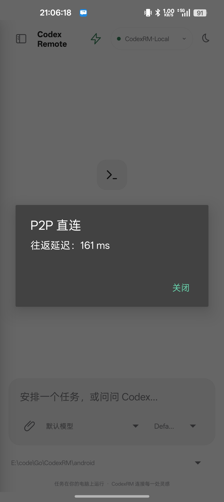

# CodexRM

自托管的 Codex 远程工作区。电脑上的 Go Agent 启动本地 Codex，通过出站 WebSocket 连接 Go 服务器；浏览器完成配对后即可远程操作。响应式 Web 界面支持深浅主题、手机布局和可安装的 PWA。

> CodexRM 是独立的社区项目，不是 OpenAI 官方产品。使用真实模式前，请安装并登录 Codex 桌面版，或自行安装并配置 Codex CLI。

```text
浏览器 ── HTTPS / WebSocket ── 中继服务器 :18080
                                  ↑ 出站 WebSocket
                              本地 Go Agent
                                  ↓ stdio / WebSocket
                            Codex app-server
```

功能包括设备配对与切换、多工作区与远程目录浏览、按文件夹筛选历史会话和分页、新建/重命名/归档会话、流式 Markdown 回复、模型和思考强度选择、权限设置、执行输出、文件 Diff、审批与用户输入、停止任务、断线重连。未发送的输入按设备、工作区和会话保存在当前浏览器中，切换或刷新后可恢复；发送在途记录独立保存，进程或页面中断后标记为“发送状态未确认”，先同步核对，不自动重发。配对失效可直接重新配对，草稿继续保留。真实会话由本机 Codex 保存；中继仅保存设备、浏览器授权和短期配对信息，不保存对话。

网页采用 DeepSeek Harness 的主题、侧栏、居中新对话页、圆角输入区、消息气泡和模型菜单布局，适配 CodexRM 的设备、工作区和 Codex 通信。模型菜单提供按供应商分组、搜索及思考强度选择。新对话沿用当前浏览器内这台设备最近选择或成功发送使用的供应商、模型和思考强度，跨工作区、刷新后保留；仅查看旧对话不会覆盖最近选择。无记录或模型已不可用时，选择可用的默认模型。复用主题和布局样式的 MIT 许可见 `web/dsh-LICENSE.txt`。

输入框旁的附件按钮可以发送文件和图片，也可以在网页输入框或页面空白处粘贴图片、拖入文件；搜索、其他输入框和弹窗保留自己的粘贴行为。支持多选、上传进度、重试、移除、仅发送附件及运行中的排队/插队发送。每个文件最大 20 MB，每条消息最多 10 个附件、合计 50 MB。PNG、JPEG、GIF、WebP 作为图像输入交给 Codex；其他文件提供电脑中的实际路径供 Codex 读取。已上传的附件草稿按设备、工作区和会话保留，网页中的历史附件支持图片预览和原文件下载。

附件分块经已配对的连接传到 Agent 数据目录的 `attachments/`，中继不保存文件；已发送的文件保留在电脑上供后续会话使用，手动移除后对应历史附件将无法下载。启用此功能需要同步更新网页、Agent 和 Server；旧 Agent 的附件入口会提示更新。

## 界面预览

### Web 工作区


### Windows Agent 设置


### Android 客户端

| 设备与工作区 | 模型选择 | P2P 直连 |
| :---: | :---: | :---: |
|  |  |  |

## PWA 与加载缓存

页面提供 Web App Manifest、桌面/移动端安装图标和 Service Worker，可通过浏览器“安装应用”使用独立窗口；iOS 提供“分享 → 添加到主屏幕”的引导。首次在线访问后会预缓存应用壳，离线仍可打开界面和恢复本地草稿，并明确区分浏览器断网与远程 Agent 离线；远程设备连接、发送任务和同步会话仍需网络。新版本下载后由用户确认更新，运行中任务或未确认发送不会被强制刷新中断。

静态加载使用三层 Cache Storage：版本化应用壳采用缓存优先，页面采用网络优先并保留离线副本，Manifest 与图标采用运行时缓存和 stale-while-revalidate。版本化 JS/CSS 同时使用浏览器一年 immutable HTTP 缓存；HTML 和 Service Worker 每次检查更新。旧版本缓存会在升级后自动清理。`/api/`、带 Authorization 的请求、非 GET、跨域请求及 WebSocket 不经过 Service Worker 缓存，会话和配对响应不会写入 Cache Storage。

## 快速开始

先在要被远程控制的电脑上安装并登录 Codex 桌面版，或在同一用户账号下配置 Codex CLI。远程操作的一侧只需要浏览器或 Android 客户端。Agent 需要保持运行，电脑休眠或退出 Agent 后，远程端将显示离线。

### 选择下载包

从 [GitHub Releases](https://github.com/CyL-Cly/CodexRM/releases) 中打开同一次 Nightly 预发布，按用途选择附件。

| 用途 | 附件后缀 | 如何使用 |
| --- | --- | --- |
| Windows x64 被控电脑 | `windows-amd64-Setup.exe` | 双击安装 Agent，启动后在系统托盘打开设置 |
| Linux x86-64 | `linux-amd64.tar.gz` | 内含 Server、`web/` 和 Linux Agent，可按需使用 |
| Linux ARM64 | `linux-arm64.tar.gz` | 内含 Server 和 `web/`，用于 ARM64 中继主机 |
| Android 手机 | `android-arm64-debug.apk` | 安装测试版客户端，扫描配对二维码 |

Linux 主机运行 `uname -m`，`x86_64` 对应 `amd64`，`aarch64` 对应 `arm64`。下载后可对照同一预发布中的 `SHA256SUMS.txt` 校验文件。Android Nightly 使用调试签名，覆盖安装需与已安装版本的签名一致。卸载旧版会清除应用内的配对信息。也可以直接使用手机浏览器。

### 首次配对和发起任务

1. 启动 Windows Agent，在系统托盘右键点击 **设置**。默认使用公共中继 `https://codexrm.ooth.tech`。使用自托管中继时，将服务器改成自己的 HTTPS 地址，填入该中继的注册密钥，保存后等待重连。
2. 等设置页显示服务器已连接，点击 **生成配对码**。配对码有效期 10 分钟，只可使用一次。每台浏览器或手机分别生成一个码。
3. 在浏览器打开同一个中继地址，输入配对码，也可扫描二维码打开配对链接。在 Android 客户端中可直接扫码，手动输入短码时同时填写中继地址。
4. 连接设备后，在侧栏 **工作区** 旁点击 **+**，浏览或输入被控电脑上的项目路径，选择 **添加此文件夹**，再为该目录新建会话。
5. 发送“请说明当前项目结构”。收到流式回复即完成验证。运行中遇到审批或用户输入请求时，先查看会话中的请求内容再决定如何处理。

### 连接问题

| 现象 | 检查方法 |
| --- | --- |
| Agent 无法连接或注册 | 检查 HTTPS 地址、证书及注册密钥，确认反向代理支持 WebSocket |
| 配对码无效 | 确认两端使用同一中继，并在 Agent 设置中生成新的码 |
| 已配对但设备离线 | 确认被控电脑未休眠、Agent 仍在运行，并检查设置页的连接状态 |
| 在线但无法开始会话 | 在运行 Agent 的账号下确认 Codex 已登录、项目目录有访问权限，并查看 Agent 日志 |
| 页面提示发送状态未确认 | 等待重连后同步会话，确认消息是否已经送达，再决定是否重发 |

```powershell
.\build\bin\codexrm-agent.exe --settings
.\build\bin\codexrm-agent.exe --restart
```

设置页首次打开时随机监听一个 `127.0.0.1` 端口，之后持续监听至 Agent 退出；再次打开复用同一端口。连接设置和日志在 `.state/` 中，设备身份继续按当前用户和服务器复用。相同配置路径的重复启动会打开已有实例的设置页；`--restart` 等待旧实例退出后重启。

已配对设备使用该浏览器检测到的完整 WebGL GPU 型号作为名称；检测不可用时回退为系统和浏览器名称。旧配对在浏览器重新连接后自动更新名称，无需重新配对。

## Linux 无桌面设置

以 `--loopback-settings` 启动 `codexrm-agent` 后，设置页只监听 `127.0.0.1`，端口和登录密码保存在连接配置相邻的 `settings-access.json`，重启时复用。用 `ssh -N -L 127.0.0.1:<port>:127.0.0.1:<port> user@host` 转发设置页，再在浏览器打开 `http://127.0.0.1:<port>/` 并输入密码。未指定设置模式时，Agent 每次启动使用临时回环端口和随机会话凭据。

确需从可信局域网直接访问时，显式传入 `--lan-settings`。此模式会把端口和随机密码保存到 `connection.json` 同目录的 `settings-access.json`（权限 `0600`），默认位置是 `~/.config/CodexRM/.state/settings-access.json`，如从安装目录的 `bin/` 启动则使用安装目录中的 `.state/`，也可通过 `--config` 指定连接配置路径。启动日志会显示端口和配置文件路径，在浏览器中用 `http://<Agent 的局域网 IP>:<port>/` 打开并输入文件中的 `password`。重启继续使用同一端口和密码，端口被占用时启动会报错。

设置页使用 HTTP；LAN 模式请通过防火墙把端口限制在可信局域网内，并优先使用 SSH 隧道，避免在不可信网络中传输密码、连接密钥和配对码。可用 `--restart` 通知同配置目录的旧实例退出，或 `--settings` 打开已有实例的设置页。

从 Linux amd64 包解压后，以运行 Codex 的普通用户执行 `./codexrm-agent --loopback-settings`，再按上文访问设置页并配对。Linux amd64 Agent 支持在设置页点击“检查更新”。运行账号需要拥有 Agent 二进制并能写入其所在目录。

### Linux OneBot 11 机器人

Linux Agent 设置页的「QQ 机器人 → OneBot 11」可直接连接 NapCat、LLOneBot、Lagrange.OneBot 等协议端，支持反向/正向 WebSocket、HTTP API + POST 事件、私聊与群聊、CQ/数组消息、图片、回复上下文和持久 Codex 会话。私聊按 QQ 授权，群聊支持仅 @ 或全部消息、全群共享或成员独立会话及管理员控制。OneBot 事件在本机 Agent 内处理，不经过 CodexRM 中继。

在设置页选择与协议端一致的连接方式，填写地址和协议端配置的访问令牌，保存后先用已授权账号发一条私聊验证。群聊可单独配置授权与触发条件。适配版本为 OneBot 11。

## 其他 Windows 电脑安装

需要在 Windows“已安装的应用”中使用 **移动** 更换安装磁盘时，使用原生 **MSIX 版 CodexRM Agent**。安装受本机信任的签名包后，在 **设置 → 应用 → 已安装的应用 → CodexRM Agent → 移动** 中选择磁盘。可运行 `.\build\scripts\package-msix.ps1` 构建；MSIX 由 Windows 管理安装、移动、更新和卸载。

双击 `CodexRM-Setup.exe` 即可打开安装向导。安装器内置 Agent，支持自定义目录和离线安装。首次启动后，可从本机设置页生成配对码或改用自托管服务器。

默认安装到 `%LOCALAPPDATA%\CodexRM`，提供开始菜单入口，可选登录自启动和桌面快捷方式。从 Windows「已安装的应用」中卸载。

构建安装器需要 Inno Setup 7。

```powershell
.\build\scripts\build.ps1 -Target Agent
.\build\scripts\package-setup.ps1
```

安装器输出到 `build/dist`。

已安装的 Windows EXE 客户端每次启动立即检查更新，之后每 20 小时检查固定更新服务器的 `update.json`，也可在 Agent 设置页手动检查。发现新版本后自动下载；有进行中的对话或排队消息时挂起安装，全部结束后自动替换并重启。失败自动回滚，保留本机配置和配对信息。更新源与远程连接服务器独立。MSIX 版由 Windows 管理更新。开发者可运行 `build\release.cmd` 构建并发布。

## 多工作区

一个 Agent 可以同时管理多个文件夹，Agent 的 `--cwd` / 安装器的 `--workspace` 只指定初始默认目录，无需为每个项目启动连接器。

1. 点击侧栏“工作区”旁的 **+**，或输入框下方的文件夹按钮。
2. 在已连接的电脑上浏览磁盘、主目录及子文件夹，也可以输入绝对路径后点击“前往”。点击“添加此文件夹”将其保存为工作区。
3. 侧栏自动加载全部未归档会话，按原工作目录分组；文件夹及组内会话均按最近更新时间排序，无需逐个手动添加。页面可见时每 15 秒同步其他客户端的新会话。点击文件夹名称展开或收起。
4. 点击文件夹旁的 **+** 或输入框下方的目录下拉框，在所选目录新建会话；已有会话保持自己的工作目录。已固定工作区旁的 **×** 取消固定，含历史会话的文件夹仍会自动显示。

固定的工作区存放在 Agent 数据目录的 `workspaces.json`，同一设备的配对浏览器共享该列表；当前选择及文件夹折叠状态按设备保存在浏览器中，刷新及切换设备后恢复。目录浏览读取的是 Agent 所在电脑，网页服务器不需要访问项目文件。

桌面端可拖动侧栏右边缘调整宽度，刷新后保留；双击边缘恢复默认宽度，聚焦边缘后也可用左右方向键调整。右键对话或点击其旁的“…”打开删除菜单，确认后从列表移除，历史仍保留在电脑的 Codex 归档中。删除正在运行的对话前需先停止任务。

权限默认采用“完整访问 + 从不请求审批”，设置会在新建会话及下一次发送时传入 Codex。若曾手动保存其他权限设置，仍使用该设置。多个审批可以分别处理或批量允许/拒绝；其他待处理问题的输入会保留，响应经连接器确认后才移除。

CodexRM 创建或恢复会话时会启用 Codex CLI 普通模式的提问功能，无需切换到计划模式。收到问题后可查看选项说明、选择答案或填写自定义回答，再点击“提交回答”；也可以点击“跳过”。普通模式的非阻塞问题会保留至回答或被 Codex 取消，已完成一轮不会直接清除问题；刷新或重连后会重新同步未处理的问题。此配置只应用于远程会话，不修改本机全局 Codex 配置。

桌面客户端占用的会话以只读快照展示，每 3 秒同步已保存消息。独立 app-server 可能将未加载的进行中轮次标为 `interrupted`；此时会结合原始生命周期记录判断，只有明确的停止事件才显示“任务已停止”。无法确认的状态显示为等待原客户端更新。

任务运行中可以继续输入消息，点击“排队发送”或按 Enter，当前任务成功完成后按顺序逐条发送；点击“插队发送”或按 Ctrl / ⌘ Enter，把补充指令追加到当前任务。Shift Enter 换行，停止按钮单独保留。排队列表支持取消消息；任务停止、失败或消息发送失败时会暂停排队，点击“继续排队”后恢复。队列由本地 Agent 在内存中管理，切换会话、刷新或关闭网页不会中断排队；Agent 或 Codex app-server 重启后队列会清空。只读会话无法排队或插队，排队需要更新本地 Agent。

## 供应商与模型

在 Windows 或 Linux 的 Agent 设置中打开「模型供应商 → 管理供应商」，即可配置支持 OpenAI Responses API 的第三方接入地址、API Key 和默认模型。配置保存在本机 Agent，Android 和网页连接这台电脑后可选择这些供应商与模型。使用 Codex 官方账号时，在电脑端 Codex 登录。

Agent 从供应商的 `/models` 接口获取模型。可以手动添加模型，也可以移除或恢复模型。移除项以删除线显示在管理列表底部，并从对话的模型菜单中隐藏。返回时一次性保存模型改动，后续刷新仍会更新上游列表并应用黑名单。

已有 CC Switch 配置可通过「从 CC Switch 导入」复制第三方供应商，并保留会话和模型黑名单的关联。重复导入只补充尚未导入的供应商。官方账号仍由本机 Codex 管理。

网页和 Android 可以在原会话更换模型。第三方供应商的会话空闲时，也可以切换到另一第三方接入点，沿用已有历史。Agent 恢复会话时从本机读取对应连接配置，客户端的供应商详情不会返回已保存的 API Key。

## 构建与测试

需要 Go 1.24+。页面使用原生 HTML / CSS / JavaScript，无需 npm 构建。Server 直接从磁盘 `web/` 目录提供页面，不使用 Go embed；更新页面只需替换该目录，无需重新编译或重启 Server。真实模式默认从 Codex 桌面版安装位置查找自带的 CLI，无需另外安装 CLI 或加入 PATH。Windows 上会检查正在运行的桌面版、Store 安装信息及各本地磁盘的常见安装目录，桌面版关闭时也可查找。直接运行 Agent 时，找不到桌面版 CLI 才使用 PATH；也支持用 `--codex` 指定 CLI 路径。

```powershell
.\build\scripts\build.ps1
.\build\scripts\build.ps1 -Linux
go test ./...
go test -race ./...
node --test web/app.test.mjs web/sw.test.mjs
node --check web/app.js
node --check web/pwa.js
node --check web/sw.js
node --check internal/agenthost/web/app.js
# 原生安装和单实例测试包含在 go test ./... 中，使用隔离目录和启动项
```

构建产物输出到被 Git 忽略的 `build/bin/`。`codex/` 上游参考源码、`ChatGPT*` 设计参考和私人部署记录不参与构建，也不包含在公开仓库中。

## 本地演示

```powershell
# 终端 1：服务端，从当前仓库的 web/ 目录读取页面
.\build\bin\codexrm-server.exe --addr 127.0.0.1:8080 --data .state/demo-server --web web

# 终端 2：模拟设备，在系统托盘运行
.\build\bin\codexrm-agent.exe --server http://127.0.0.1:8080 --mock --data .state/demo-agent

# 生成配对码
.\build\bin\codexrm-agent.exe --server http://127.0.0.1:8080 --mock --data .state/demo-agent --pair
```

访问 http://127.0.0.1:8080 并输入配对码。模拟模式支持流式回复、历史、重命名、归档、停止；发送含“审批”的任务可测试审批回传。模拟会话只保存在内存中，不调用模型或执行命令。也可运行 `build/scripts/dev-mock.ps1` 一键启动。

## 连接真实 Codex

默认由 Agent 启动 `codex app-server --listen stdio://`，继承当前用户的 Codex 登录与配置：

```powershell
.\build\bin\codexrm-agent.exe --server https://your-server.example --cwd D:\projects\my-project
```

支持 `--codex <可执行文件路径>`。Agent 运行独立 app-server，可列出、恢复同一 Codex 用户目录中可见的历史会话。另一个实例仍持有写入锁的会话以只读历史展示，结束原会话后可重新打开继续。

也可连接已有 app-server：

```powershell
codex app-server --listen ws://127.0.0.1:4500
.\build\bin\codexrm-agent.exe --server https://your-server.example --appserver ws://127.0.0.1:4500
```

若该 WebSocket 要求 Bearer token，设置 `CODEXRM_APPSERVER_TOKEN` 或传入 `--appserver-token`。浏览器刷新会保留配对；重新进入会话时从 Codex 同步历史。连接中断时不重放用户任务，避免重复执行。

## 自行部署

以下示例适用于有 systemd 的 Linux 主机。准备与主机架构匹配的 Server 包，以及已指向主机的域名和 TLS 证书。部署脚本、systemd 单元和 Nginx 示例位于源码仓库。

```bash
git clone https://github.com/CyL-Cly/CodexRM.git
cd CodexRM
# 将路径替换为下载的 Linux amd64 或 arm64 包
archive=/path/to/CodexRM-nightly-…-linux-amd64.tar.gz
mkdir -p server-package
tar -xzf "$archive" -C server-package
sudo bash build/scripts/install-server.sh ./server-package/codexrm-server ./deploy/codexrm.service ./server-package/web
curl -fsS http://127.0.0.1:18080/api/v1/health
```

从源码部署时，可用 `CGO_ENABLED=0 go build -trimpath -ldflags '-s -w' -o codexrm-server ./cmd/codexrm-server` 构建当前 Linux 架构，再将二进制和仓库的 `web/` 分别传给同一个安装脚本。源码构建需要 Go 1.24 或更高版本。

1. 将 `deploy/nginx-location.conf` 中的代理配置合入中继域名的 TLS `server` 块，保留 WebSocket 升级请求头。运行 `sudo nginx -t`，通过后执行 `sudo systemctl reload nginx`。
2. 从客户端网络访问 `https://你的中继域名/api/v1/health`，确认返回 `ok: true`。若本机健康检查失败，用 `sudo systemctl status codexrm` 和 `sudo journalctl -u codexrm -n 50 --no-pager` 排查服务。
3. 从服务器上的 `/opt/codexrm/server.env` 私下读取 `CODEXRM_ENROLL_KEY`，在 Agent 设置中填入中继的 HTTPS 地址和该密钥。服务器地址和注册密钥保存后，按上面的流程生成浏览器或 Android 配对码。

服务监听 `127.0.0.1:18080`，程序位于 `/opt/codexrm/bin`，页面位于 `/opt/codexrm/web`，持久化状态位于 `/opt/codexrm/data`。升级前备份状态目录和权限为 `0600` 的 `server.env`。解压新版本后再次运行安装脚本即可更新二进制和页面并重启服务，脚本沿用已有注册密钥。注册密钥、设备 token 和配对码均应按凭证保管。

注册密钥仅用于 Agent 注册；浏览器使用 10 分钟有效的一次性配对码换取专属 token。服务器记录配对设备的最近连接时间及 IP，Agent 设置页可查看；在线心跳持续更新时间。服务器启动时及每分钟清理超过 7 天未连接的设备授权，持续在线的设备保留；升级前缺少连接记录的设备给予一次性的 7 天宽限，重启不会延长。设备信息 API、WebSocket、解除配对均校验凭据；支持 Origin 检查和设备间路由隔离。可在 Agent 设置的“已配对设备管理”中删除授权，删除后立即失效并需要重新配对。默认无注册密钥时仅接受直接来自 loopback 的注册，反向代理场景需配置注册密钥。配对浏览器可以操作对应电脑上的 Codex，权限由新会话的 sandbox 与审批设置控制。

## 结构与接口

```text
cmd/codexrm-server/   HTTP / WebSocket 服务入口
cmd/codexrm-agent/    本地连接器入口
internal/agent/      出站重连、RPC 并发与审批回传
internal/appserver/  Codex stdio / WS 客户端与模拟服务
internal/server/     配对、鉴权、中继与磁盘静态 UI
internal/store/      JSON 状态原子持久化
internal/protocol/   中继消息结构
web/                 响应式前端
deploy/              systemd 与 Nginx 示例
build/scripts/       开发构建、发布与服务器安装脚本
```

| 接口 | 用途 |
| --- | --- |
| `GET /api/v1/health` | 健康检查 |
| `GET /update.json` | Windows 客户端自动更新清单 |
| `GET /android-update.json` | Android 客户端手动更新清单 |
| `GET /linux-update.json` | Linux amd64 Agent 更新清单 |
| `POST /api/v1/agent/enroll` | 注册/续期，远程注册需 `X-Enrollment-Key` |
| `POST /api/v1/agent/pair` | Agent 生成配对码 |
| `GET /api/v1/agent/pair/status` | 查询配对状态，需 Agent token |
| `GET /api/v1/agent/clients` | 列出已授权浏览器，需 Agent token |
| `DELETE /api/v1/agent/clients/{clientId}` | 删除浏览器授权，需 Agent token |
| `GET /api/v1/agent/ws` | Agent WebSocket |
| `POST /api/v1/client/claim` | 浏览器认领配对码 |
| `POST /api/v1/client/profile` | 浏览器凭自身 token 更新设备名称和类型 |
| `POST /api/v1/client/revoke` | 撤销当前浏览器 token 并断开连接 |
| `GET /api/v1/client/ws` | 浏览器 WebSocket |
| `GET /api/v1/agents` | 返回浏览器已授权的设备 |

更新服务器只发布更新清单。客户端按清单中的 `downloadUrl` 从外部存储下载对应平台的 ZIP 或 APK。项目的发布脚本使用 Cloudreve，自托管时也可使用 OSS、EOS 等对象存储。自托管时将清单放在 Server 数据目录的 `updates/` 下，并填写与发布文件对应的版本、下载地址、文件大小和 SHA-256。

普通请求通过 `Authorization: Bearer <token>` 认证。浏览器 WebSocket 使用 `codexrm` 和 `codexrm.token.<token>` 子协议传递凭据，避免 token 出现在 URL 及普通访问日志中。中继的 `message` 包含 Codex JSON-RPC；`codexrm/info` 是 Agent 提供的运行状态接口。请求 ID 在 Agent 内映射，支持多个浏览器各自从相同 ID 开始发送请求。

Agent 还提供 `codexrm/workspace/list`、`codexrm/workspace/add`、`codexrm/workspace/remove` 和 `codexrm/fs/list` RPC，经过已有的设备配对鉴权。添加/移除及浏览使用 `{ path }` 参数；浏览可加 `showHidden`。会话筛选使用 Codex 原生 `thread/list` 的 `cwd` 参数，在分页前按目录筛选。

## 贡献与安全

欢迎通过 Issue 和 Pull Request 参与。安全漏洞请使用 GitHub 仓库的私密漏洞报告渠道，避免公开凭据或未修复的漏洞细节。仓库只跟踪根目录的 `README.md`，其余 Markdown 文档保存在本地。

## 许可证

本项目以 [MIT License](LICENSE) 开源。Codex、OpenAI 及其他第三方名称和标识归其各自所有者所有；本项目不提供或许可第三方 Codex 客户端及其源码。
