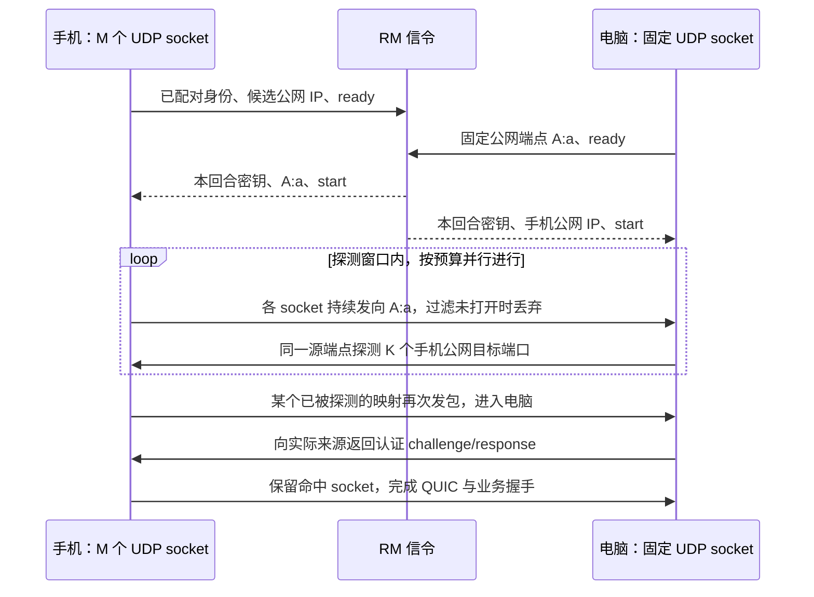

# Agent ↔ Android P2P：资料与实施准备

日期：2026-11-18（Asia/Singapore）。状态：调研与设计，尚未实现、部署或开展真机打洞实验。
仓库观察基线：HEAD `94fb6f1` 加当前工作区；工作区已有大量未提交修改。本文描述观察时的源码，不推定它们已经发布。

## 1. 已确认的目标

- 用户将提供处于 **Symmetric NAT 的 Android 手机**；电脑 Agent 处于 **Port Restricted Cone NAT**。
- 这组设备的 **P2P 直连成功率必须 >50%**。TURN、RM WebSocket 或其他服务器转发业务数据的成功，一律不进入直连成功分子。
- 沿用现有 RM 做配对与信令，允许部署 STUN/TURN。
- 保留双方 Port Restricted Cone NAT 的高成功率目标，作为回归项。
- 本次工作仅搜集资料、明确路线和验收方法。>50% 是待达成的验收要求，目前没有这组设备的实测证据。

建议默认每次尝试允许 20 秒直连探索；这是设计参数，用户尚未指定最大耗时。报告同时给出 3/5/10/20 秒累计成功率，不能只公布无限重试后的最终结果。

## 2. 结论与路线选择

**优先做可控制 UDP socket 的共享 Go 穿透核心，在 Android 通过 gomobile AAR 调用；穿透后沿用命中的同一个 socket 建立 QUIC。** 对照组采用标准 ICE/WebRTC，以比较新增策略实际带来的收益。

采用分层策略：

1. 局域网、可用 IPv6、普通 UDP 双向探测，先走低成本直连。
2. 对有稳定端口分配规律的 Symmetric NAT，做有限窗口预测。
3. 对无稳定规律的单侧 Symmetric NAT，采用 **手机多源端口建映射 + 电脑固定源端口随机探测** 的交集碰撞。
4. 直连探索与 RM 现有业务中继并行；失败继续中继，成功才安全切换。TURN 可作为 UDP 中继候选，单独统计。

理由：RFC 5128 §3.5 说明端口预测仅适用于部分端点相关映射，且受其他会话和多层 NAT 干扰。[S2] frp 的实际源码有单侧 HardNAT 的预测模式，以及多监听端口/随机目标端口模式，值得提取验证思路。[S6][S7] 这些都不是该手机环境达到 >50% 的证据。

普通 WebRTC 很适合标准 ICE 和 DataChannel，但本项目最难的要求是控制大量源 socket 和探测调度。仅配置更多 STUN/TURN 地址不能替代这项能力。若选择 libwebrtc，需先证明能在其实际 ICE socket 上实现所需策略；不要在外部另开 socket 打洞，再让 WebRTC 重建连接。

## 3. 为什么这一对 NAT 难

使用 RFC 4787 的两个维度描述，不只记录一个 NAT 标签：[S1]

| 端 | 重点核实的行为 | 对连接的影响 |
| --- | --- | --- |
| 电脑 Port Restricted Cone | EIM：相同内部 UDP 端点的映射不随目标改变；APDF：仅接收曾发包到的目标 IP:port | 公网端点可保持固定，但必须主动向手机的真实公网端点发过包 |
| 手机 Symmetric | ADM/APDM：映射随目标 IP 或 IP:port 改变；另测过滤行为 | STUN 观察到的端口未必是手机发往电脑时的端口 |

Symmetric 映射不自动说明其过滤规则，也不代表所有蜂窝网络都如此。以提供设备和当前 APN、网络路径的检测结果为准。CGN 本身也不能直接等同 Symmetric NAT。[S1][S12]

设电脑公网端点是 `A:a`，手机向 STUN 的映射是 `P:s`，手机向 `A:a` 的映射是未知的 `P:p`：

```text
手机 -> STUN     得到 P:s
手机 -> A:a      产生 P:p；电脑未向 P:p 发过包，入站可能被丢弃
电脑 -> P:s      手机对 STUN 的映射未必接收来自 A:a 的包
```

标准 ICE 的 peer-reflexive candidate 能学习实际收到的来源；但是被前置过滤丢弃的包没有来源可供学习。因此它不是任意 Symmetric + Port Restricted 组合的保证。[S3]

两端均 EIM+APDF 时，则应从各自固定 socket 向对端映射持续发送有节奏的探测与应答；第一次被丢弃后，后续包可利用已打开的过滤状态。此项保留为普通模式回归。

## 4. 核心方案：单侧 Symmetric 的端口交集碰撞

### 4.1 必须保持的条件

1. Agent 用一个未连接的 UDP socket `U_A` 探测 STUN、向手机发探测包，并接收返回包；不能用只接受 STUN 来源的 connected UDP socket。
2. 用不同目的地址检测 `U_A` 的公网映射，确认当前路径确实表现为 EIM，并在整个回合保留 `A:a`。
3. 手机创建 M 个不同本地 UDP socket，每个都向 **同一个 `A:a`** 发带认证的探测；得到 M 个面向电脑的实际公网映射。不能用一个 socket 发往 M 个 STUN 目标，冒充这 M 个映射。
4. Agent 从 **同一个 `U_A`** 向手机公网 IP 的 K 个不同目标端口发送探测，从而打开相应 APDF 过滤状态。
5. 手机各 socket 在回合期间重复向 `A:a` 发包。Agent 开放某个 `P:p` 后，后续手机包才能进入电脑；Agent 立即向该来源原端口返回认证应答。
6. 验证双向 challenge/response，选出命中 socket。选定后停止其他探测，关闭多余手机 socket。
7. 手机保留选中 socket，电脑保留 `U_A`，直接在这对端点上建立 QUIC，完成身份绑定和业务握手。



这是针对一端 EIM、一端目标相关映射的策略。不能把同样参数下的结果外推到双侧 Symmetric。[S5][S6][S7]

### 4.2 理论预算与边界

若手机在**同一正确公网 IPv4** 下有 M 个不同、仍存活的可达映射；Agent 在 N 个可能端口中无放回均匀探测 K 个，理想命中概率为：

```text
P = 1 - C(N-M, K) / C(N, K)
  ≈ 1 - exp(-M*K/N)
```

以下用 N=65535，按乘积公式重新计算；属于模型计算，不是设备测量：

| 手机不同映射 M | 电脑不同目标端口 K | 理想命中概率 |
| ---: | ---: | ---: |
| 1 | 1024 | 1.56% |
| 128 | 512 | 63.39% |
| 256 | 256 | 63.36% |
| 256 | 512 | 86.63% |
| 256 | 1024 | 98.24% |

公式只估算端口集合相交；真实成功还要求 IP 正确、映射未过期、探测时序重叠、没有限速和丢包、认证与 QUIC 握手成功。若 256 个 socket 只有 64 个映射有效，就必须按有效数量解释结果。不能把 98.24% 写成产品成功率。[S5]

特别处理：运营商多公网 IP 池、按目的地址切换出口、每用户端口块、映射/过滤容量不足、双层 NAT、UDP 限速。STUN 看到的 IP 未必就是面向 Agent 的出口；多个 IP 应分配独立探测预算，不能仍声称单 IP 模型概率。

### 4.3 初始实验参数，不直接视为生产默认值

- 先比较 M=32/64/128/256，K=256/512/1024，观察达到 >50% 所需的最小成本。
- Agent 目标端口去重、随机无放回；有可靠端口块或分配规律时，先验证再缩小搜索空间，保留全范围对照。
- 随机阶段 Agent 初始约 100 包/秒；手机所有 socket 合计不超过 256 包/秒，刷新错峰安排。
- 手机映射初始每 2 秒向固定 `A:a` 刷新一次；根据实测生命周期和丢包调整。
- 单回合总探测发包预算建议先封顶 4096，含双方刷新、应答和其他阶段；20 秒硬截止。预算不足必须明确记录，不能静默少发后仍套用理论参数。
- M=256、K=1024 的初始预算需要约 10 秒电脑探测时间，加创建/同步/刷新时间；不能同时宣传它是 2 秒内完成的保证。
- 默认使用正常 TTL。frp 有低 TTL 与正常 TTL 变体，但低 TTL 能否跨越所有 NAT、ICMP 是否影响映射取决于拓扑，不作为首版依赖。[S6][S7]
- 同一 Android 设备/Agent 组合只跑一个扩展回合；失败后退避，不能无限循环重建数百映射。所有回合均绑定已配对身份、明确的对端 IP、随机会话密钥与发包限额。

### 4.4 预测模式的定位

从同一个 socket 向不同 STUN 地址交错采样，观察映射差值、目的相关性和抖动。仅在重复采样表现稳定时试探有限窗口，并让手机持续向 `A:a` 发包；很快转入随机多映射模式。运营商并发分配可能破坏序列，不能默认 `STUN 端口 + 1`。[S2]

## 5. 软件栈与取舍

| 路线 | 优点 | 本项目需要先解决的限制 | 定位 |
| --- | --- | --- | --- |
| 共享 Go UDP 核心 + QUIC，Android 用 gomobile | 两端复用探测/调度逻辑，容易控制 socket 生命周期和多映射 | Android AAR/NDK、包体和内存开销；系统网络绑定；QUIC 同 socket 接管 | 优先验证 |
| Go Pion WebRTC + Android libwebrtc | 标准 ICE、DataChannel、TURN 互通路径 | 多源 socket 碰撞不应假设开箱即用；可能要改 ICE 层；原生依赖构建维护 | 标准对照与备选 |
| 直接引入完整 frp/EasyTier/VPN 产品 | 可借鉴现有穿透策略 | 控制面、身份、流量语义与 CodexRM 不同；集成成本需另评估 | 不直接替换架构 |
| TCP simultaneous-open | 特定环境可能有效 | 内核与 NAT 行为复杂，不能作为本次 >50% 的主要依据 | 后续补充 |

frp `pkg/nathole` 是研究优先项：`analysis.go` 区分预测与随机端口策略；`MakeHole` 接受已有 socket，并返回命中的 socket 和实际远端。该包依赖 frp 自身信令等模块，不能当作一个独立、稳定 API 直接承诺集成。[S6][S7] 如提取源码，应锁定 commit，保留 Apache-2.0 授权声明并核对依赖许可。

gomobile 官方支持生成含 Java API 和原生共享库的 AAR。[S8] 这会改变当前 Android 无原生 ABI 库的构建条件；阶段一测量 release APK 体积、首连耗时、峰值 FD/内存、退出后的资源释放，并验证 16 KiB page size 兼容性。

quic-go 官方 `quic.Transport` 支持已有 `net.PacketConn`，也提供读取非 QUIC 包的入口。[S9] 优先用它对 STUN/探测包做分流，明确只有一个读取者拥有底层 socket；禁止探测循环与 QUIC 两个 goroutine 直接竞争 `ReadFrom`。探测包格式应与 QUIC 的首部区分规则兼容。使用该 API 前核对锁定版本的具体行为。

当前仓库 `go.mod` 声明 Go 1.22；调研中的上游开发分支不构成兼容版本承诺。先选受维护版本、核对最低 Go/Android/NDK 要求，再决定升级工具链并同步 CI，不能直接使用未锁定的 `@latest`。

QUIC 负责可靠流、加密与拥塞控制，不负责猜出 NAT 端口。握手必须在穿透成功的原 socket 上进行；手机作为 QUIC 拨号端、Agent 作为接受端，第一版先采用显式重连，不承诺跨网络无缝迁移。[S9][S10]

## 6. RM、STUN 与 TURN

### 6.1 RM 信令

保留现有 WSS 长连接和配对令牌认证，新增受限的 `p2p/*` 信令：

- `hello/capabilities`：是否支持扩展穿透、协议版本、预算上限。
- `prepare/ready`：sessionId、generation、双方身份、候选端点、临时公钥/指纹、预算与准备完成状态。
- `start`：双端均 ready 后开始，使用本地单调计时和接收确认，避免要求手机与电脑墙钟严格同步。
- `result/select/close`：双向握手结果、实际端点、所选路径、停止原因。

RM 必须从认证连接确定 agentId/clientId，不能相信 JSON 中自报的身份；信令只能发送给已配对且归属匹配的设备。老版本忽略新能力并继续 WebSocket。

### 6.2 STUN 与 NAT 行为检测

至少准备两个公网 IPv4 地址、不同端口的可控测试端点，覆盖同 IP 不同端口和不同 IP 的观察。完整映射/过滤诊断需要服务器明确支持 RFC 5780 的替代来源/地址行为；两个普通公共 STUN 响应并不能证明全部 NAT 特性。[S4]

STUN 检测必须复用实际参与打洞的 socket；可另外做诊断 socket，但其观察不能冒充实际业务 socket 的映射。需要记录 IPv4/IPv6、UDP 可用性、映射目的相关性、外部 IP 是否稳定、有效映射数量和存活时间。探测不完整时记为 unknown，仍可做限额尝试。

### 6.3 TURN 与业务回退

TURN 是中继，不计 P2P。第一版已有 RM WSS 回退可直接复用；如加入 coturn，优先验证 TURN/UDP，再验证 TURN/TCP/TLS 的客户端支持、allocation/permission/channel 的创建与刷新。TURN 可独立于 ICE 使用，但自定义 QUIC 路线仍需显式实现 TURN 客户端及 PacketConn 适配。[S11][S13]

TURN/TLS 可规划独立公网 IP 的 443/TCP；仅开放 443 不等于所有代理网络可用，也不能直接按普通 HTTP 反向代理规则转发。另需开放实际 relay 端口范围，配置短期凭据、配额和证书。TURN 不必和现有 RM 共用进程。

**中继先可用，直连后台探索**：用户可以先通过 WSS 使用；到 20 秒截止仍未直连，则本次直连失败。之后人工重试属于下一次回合。TURN/WSS 上已收到回复也不能提前终止直连试验并从分母剔除。

## 7. 结合当前源码的改造边界

| 当前源码 | 已观察到的耦合 | 后续改造 |
| --- | --- | --- |
| `internal/protocol/types.go` | Envelope 已有 clientId、streamId、seqId | 新增能力和信令版本；定义 session/generation/requestId 的作用域 |
| `internal/server/server.go` | 客户端身份由 RM 注入；seqId 由 RM 分配；定向/广播都经 RM | 校验 P2P 信令路由；增加撤销通知；不要把 RM seqId 当作直连事件序号 |
| `internal/agent/agent.go` | session/handle/respond 直接接收 WebSocket；forward 依赖 a.relay | 抽出经过认证的 PeerSession 与传输接口；统一请求入口、审批归属和事件出口 |
| `internal/agent/queue.go` | 队列更新通过 a.relay 广播 | 同时支持按各客户端当前有效路径发送，避免重复通知 |
| `internal/agent/attachments.go` | 现有附件 RPC chunkSize=256 KiB | QUIC 流采用显式长度与上限；先保留业务分块，再评估独立附件流 |
| Android `CodexClient.kt` | RPC pending、online、重连和 WSS send 耦合；已有 generation | 传输管理器与 RPC 分离；WSS 信令断开不直接等同直连业务中断 |
| Android `MainActivity.kt` | onStop 主动 disconnect | 第一版保留前台通信语义，后台停止扩展探测并释放额外 socket |
| Android `Network.kt`、Manifest | 网络集中于 OkHttp；当前未声明 ACCESS_NETWORK_STATE | 接入 ConnectivityManager 回调并核对所需权限；处理默认网络变更 |

这些是观察到的改造点，不是已实现的接口承诺。实现时再次读取当前文件，避免覆盖并行修改。

### 7.1 切换不能重复执行任务

- 同一 clientId 同时只有一个有效业务发送路径；WSS 仍可保留用于信令、撤销和回退。
- 切换需双方确认新路径已完成认证和业务握手；旧路径仍在途的响应保留其原始归属。
- 为有副作用的 RPC 定义 `(clientId, requestId)` 去重、执行中状态及短期结果缓存，requestId 不因重连复用；明确缓存生命周期与 Agent 重启边界。
- 请求已发出但响应丢失时，不能盲目在 WSS 重发 `turn/start`、审批或写文件。未实现可靠去重的操作提示状态未知，并通过查询/快照恢复。
- 事件使用 Agent 自己的序号与 session generation 去重；出现缺口重新同步会话快照。广播给每个在线客户端各一次，审批仍只给正确 owner。
- 历史、附件、排队、插队、停止、审批等业务语义保持一致，不能把 pending map 在每次传输变化时全部当作未发送。

### 7.2 身份与撤销

探测 HMAC 只验证本回合探测包；真正业务连接仍需 QUIC/TLS 双端身份绑定。首次通过可信 WSS 分发临时公钥/指纹，并把 agentId、clientId、sessionId、generation 纳入握手认证。默认信任已认证的 RM；若未来要求不信任 RM，应另行在配对时交换并持久化端到端身份公钥。

当前撤销只关闭 RM 上的连接，新增直连后必须同步通知 Agent 主动销毁该客户端会话、探测和密钥。为 RM 暂时不可用的情况，建议使用例如 60 秒的可续期授权租约，过期停止接受新控制请求并关闭直连；运行中的 Codex 任务不因此取消。租约、撤销延迟和离线直连能力需要作为同一个产品决策，不能默认同时保证即时撤销与长期离线直连。

## 8. Android 专项

- 使用系统 NetworkCallback 感知默认网络变化；同一 Wi-Fi 重新连接也可能是新的 Network。切换时取消旧 generation、清掉旧公网候选、重新检测与打洞。[S14]
- 默认只使用当前有效网络，避免未经需求确认同时请求蜂窝与 Wi-Fi。若需把 Go socket 绑定到特定 Network，先做小型桥接验证，在连接前用官方 bindSocket/NDK 网络接口处理并核对权限；不能假定 gomobile 自动完成绑定。[S15]
- 维持当前前台连接模型；onStop 关闭探索 socket，回前台重新连并恢复快照。Doze 会限制后台网络，保活包不能保证后台常连。[S16]
- 检验最多 256 socket 在真实手机上的 FD、映射配额、内存、线程和耗电；减少跨 Kotlin/Go 的每包回调，由 Go 核心处理调度，Kotlin 接收聚合状态和业务消息。
- 网络丢失、设备切换、取消、授权撤销、超时、Activity 停止等所有出口都验证关闭 FD，不把失败路径残留变成下一次试验的“预热”。

## 9. 验收设计：证明 >50%

### 9.1 单次成功与统计分母

主指标固定为 **提供的手机 Symmetric IPv4 ↔ 本机 Port Restricted IPv4，在单回合 20 秒内完成直接 QUIC/TLS 认证及双向业务 RPC**。

- 先独立表征网络，不能仅凭某 NAT 检测器显示的标签认定测试条件。
- t0 为 Android 前台发起本回合连接的本地单调时间；主结果包括信令/STUN/建 socket/探测/认证/RPC 的总耗时。另记双方 ready 后的纯探测耗时，不能替代总耗时。
- 一次回合可包含预测和随机等内部阶段；所有阶段合计最多 20 秒，不把同一回合的多次内部成功/失败拆分刷高成功率。
- 每次新回合新建手机探测 socket 和 sessionId；冷启动组也更换 Agent socket。保留 Agent 端口的暖启动组单列。
- 关闭可转发业务的回退，或通过双方计数器证明成功业务帧确实走直连。抓包核实远端为双方公网端点，而非 TURN/RM。
- UDP 探测命中、QUIC connected 回调、TURN connected 均不单独算成功；必须有认证后的双向业务请求/响应。
- 端口耗尽、网络 IP 变化、超时、STUN/RM 不可达等记录具体原因并保留在整体结果中。可另报告预先定义的“UDP/信令可用子集”，不能事后删除失败以过线。
- IPv6、同 LAN、手工端口转发成功单列为其他直连路径，不进入这项 IPv4 Symmetric/Port Restricted 打洞分子。生产仍可优先使用它们。

### 9.2 样本与判定

1. 探索集每组至少 30 回合，用于选 M/K、速率和窗口；探索结果不作最终达标报告。
2. 锁定参数后，目标手机/电脑组合至少 **200 个新回合**，分时段执行并保留全部原始记录；手机数量、运营商、APN、4G/5G、网络代际切换等分层报告。
3. 验收要求观测成功率 >50%；建议同时要求 **95% Wilson 区间下界 >50%**，避免小样本偶然性。例如 120/200=60%，Wilson 下界约 53.1%，比 101/200 更能支持结论。
4. 相邻重试不是完全独立样本，需按时段/网络重建分批报告；同一手机达到要求不代表其他运营商也达标。
5. 双方 Port Restricted 的回归建议每种配置至少 200 回合，先以 ≥99% 为工程目标，另报告置信区间。此目标尚未经实验确认。

### 9.3 测试矩阵

| 环境 | 目的 |
| --- | --- |
| 真实手机蜂窝 ↔ 真实本机 PRC | 主验收，必须实机 |
| 可控 EIM+APDF ↔ EIM+APDF | 普通双向打洞回归 |
| 可控 APDM+APDF ↔ EIM+APDF | 验证顺序、随机、端口块等映射行为 |
| 每用户映射限额 32/64/128/256 | 确认有效 M 与成功率/资源的关系 |
| 1%/5% 丢包、100/300ms RTT、短映射/过滤超时 | 重传与刷新是否可靠 |
| 手机公网 IP 池/地址变更、双层 NAT、UDP 禁止 | 识别边界并验证回退，不伪报直连 |
| Wi-Fi ↔ 蜂窝、退后台再返回、电脑睡眠恢复 | 旧候选和旧 generation 清理 |
| 两客户端同时控制、撤销、RPC 在途切换 | 路由隔离、任务不重复与权限一致 |

实验 NAT 可用独立 Linux 网关/网络命名空间或明确实现映射与过滤模型的代理。**普通 SNAT/MASQUERADE 规则本身不能证明模拟出了 EIM+APDF/APDM。** 用多个外部 IP/端口的独立探针检验映射和过滤，再计入该类型的统计。Go 虚拟网络测试只能作为逻辑验证，不能代替 Android 真机及真实内核网络路径。

连接后的稳定性另外测：30 分钟前台空闲与间歇操作、长流式回复、20 MiB 附件往返 SHA-256、并行审批与上传、回退后恢复快照。它们与首次打洞成功率分开报告。

每回合至少输出：build/参数、匿名设备组、运营商/APN分组、网络代际、mapping/filtering、公网IP是否变化、实际socket数、估计有效映射数、M/K/发包与丢包、阶段耗时、探测/认证/RPC结果、selectedPath、失败原因。公网地址和密钥不写入公开报告。

## 10. 实施顺序与停止条件

### A. 测量入口与标准对照

增加独立诊断工具及最小 Android 测量入口，RM 只传认证信令；准备支持多地址的 STUN。输出双方 NAT 特征、普通双向探测及标准 ICE 对照结果。冻结真实手机实验条件。

交付：可重复的诊断记录、基线成功率和环境说明。暂不改主业务路径。

### B. 多映射碰撞 PoC

复核并锁定 frp 参考 commit，实现/提取最小策略；共享 Go 核心经 gomobile 调用。先证明原 socket 的认证探测双向命中，再接入 QUIC 并确认没有重建端口。完成 M/K 探索及 200 回合锁参验证。

交付：直接业务 echo、全量回合结果、成功率/区间/耗时/资源，明确是否达到 >50%。**这一步不达标就继续定位公网 IP 池、有效映射和限速等原因；不能用 TURN 结果替代过线，也不提前进行大规模 UI/主协议改造。**

### C. 业务传输解耦与切换

为 Agent 与 Android 引入 PeerSession/TransportManager，复用现有 JSON-RPC；处理广播、审批、队列、附件、请求去重和事件重同步。加入撤销与授权租约。保留 WSS 回退和能力协商。

交付：现有功能回归、网络切换、在途 RPC 和多客户端隔离证据。

### D. 基础设施与发布前验证

按确有必要的回退路径部署 TURN，锁定依赖和工具链；测 release AAR/APK 体积与资源，验证 Android ABI/16 KiB page size，完成真实设备验收。分开发布 IPv4 打洞率、IPv6直连率、中继率、总可连接率。

## 11. 当前尚未证明的事项

- 提供的手机在实际发往本机时是否保持同一公网 IP、可维持多少有效 UDP 映射，以及运营商是否对探测限速。
- 256 socket 等预算对该手机的成本；最低成本达到 >50% 的 M/K 与超时。
- 自定义 QUIC 路线的 Android 网络绑定、选中 socket 接管及 release 构建。
- 当前 RM 部署能否提供所需多公网地址/UDP 端口；允许部署不代表已经配置完成。
- >50% 的真机成功率。本次仅形成验证路径，不能承诺所有 Symmetric NAT 都能达到相同指标。

## 12. 原始资料索引

以下均于 2026-11-18 调研。RFC 为规范或历史机制说明；项目源码是可执行策略参考；理论碰撞概率与本项目设备实测严格区分。移动开发分支在实现时必须改为固定 commit/tag，不能把本次在线内容当作永久版本基线。

| 编号 | 原始资料与重点 | 地址 |
| --- | --- | --- |
| S1 | RFC 4787 §4.1/§5：映射与过滤分离描述 | `https://www.rfc-editor.org/rfc/rfc4787` |
| S2 | RFC 5128 §3.3/§3.5：UDP 打洞、端口预测及限制 | `https://www.rfc-editor.org/rfc/rfc5128.html` |
| S3 | RFC 8445：完整 ICE、候选检查、peer-reflexive | `https://www.rfc-editor.org/rfc/rfc8445` |
| S4 | RFC 5780：NAT 行为诊断；Experimental，不是所有 STUN 都支持 | `https://www.rfc-editor.org/rfc/rfc5780` |
| S5 | Tailscale 作者技术文章：单侧困难 NAT 的多映射/随机端口交集模型；不是当前产品行为承诺 | `https://tailscale.com/blog/how-nat-traversal-works` |
| S6 | frp 策略源码：mode1 预测、mode2 多监听端口与随机探测 | `https://raw.githubusercontent.com/fatedier/frp/dev/pkg/nathole/analysis.go` |
| S7 | frp MakeHole：多 socket 探测与返回命中的连接 | `https://raw.githubusercontent.com/fatedier/frp/dev/pkg/nathole/nathole.go` |
| S8 | Go 官方 gomobile：bind 生成 Android AAR | `https://pkg.go.dev/golang.org/x/mobile/cmd/gomobile` |
| S9 | quic-go 官方：已有 PacketConn、同 socket、非 QUIC 包处理 | `https://quic-go.net/docs/quic/transport/` |
| S10 | RFC 9000：QUIC 流、端点和路径验证 | `https://www.rfc-editor.org/rfc/rfc9000.html` |
| S11 | RFC 8656：TURN；可以独立于 ICE 使用，仍是中继 | `https://www.rfc-editor.org/rfc/rfc8656.html` |
| S12 | RFC 6888：CGN 行为要求；不能仅凭 CGN 标签认定 Symmetric | `https://www.rfc-editor.org/rfc/rfc6888.html` |
| S13 | coturn 官方仓库：STUN/TURN 服务端及部署入口 | `https://github.com/coturn/coturn` |
| S14 | Android 官方：动态网络状态、NetworkCallback 与 Network 生命周期 | `https://developer.android.com/develop/connectivity/network-ops/reading-network-state` |
| S15 | Android Network API：bindSocket 与 socket/network 约束 | `https://developer.android.com/reference/android/net/Network` |
| S16 | Android 官方：Doze 与 App Standby 网络限制 | `https://developer.android.com/training/monitoring-device-state/doze-standby` |
